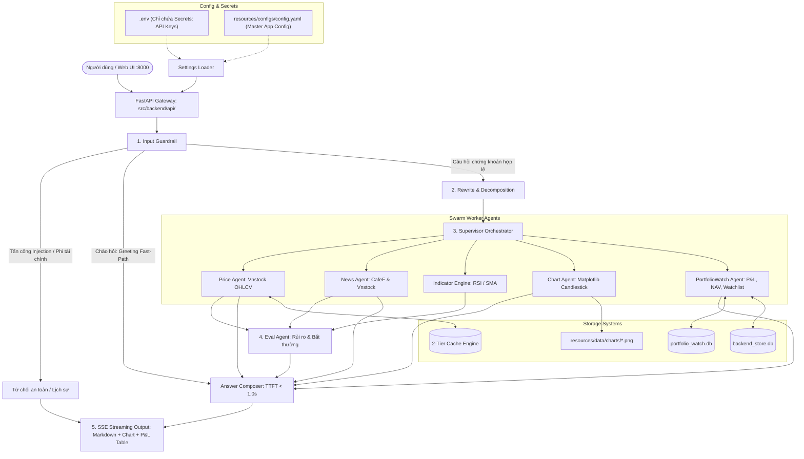

# VN Stock Swarm & Portfolio Watch — Đồ Án Cuối Khóa LLM Engineer

Hệ thống Trợ lý Phân tích Chứng khoán Đa Tác tử (Multi-Agent Swarm) và Quản lý Danh mục Đầu tư Đa Tài khoản (Multi-tenant Portfolio Watch), phát triển theo phương pháp **Spec-Driven Development (SDD)**.

## Đợt cập nhật hiện tại (chưa code)

Port các thay đổi **sau** commit `01bd4505d59d95358732ed074a14fcf52ff66e20` (`cost optimization`) đến `6e5e32e` của `llm-engineer-demo` sang app này. Mốc `01bd450` là baseline đã có (cost tracker, exact cache). Không viết lại swarm, golden set, hay RAG pháp lý.

Spec: [specs/product-spec.md](specs/product-spec.md), [specs/implementation-plan.md](specs/implementation-plan.md), [specs/test-plan.md](specs/test-plan.md).

Module III Bài 1–8 đã có trong code (prompt, eval gate, cache, Docker, CI/CD, tracing, HITL). Việc còn lại, từng ô một:

1. Async client cho `chat_stream` (ngắt SSE đã có).
2. Cho SSE đi qua exact cache; thêm Redis store, mặc định vẫn memory.
3. Script rollback alias `production` (lint đã có).
4. Sampling bỏ cache hit; thêm tín hiệu copied / regenerated / abandoned.
5. Secret Manager thật, lỗi thì giữ `.env` (`secrets.py` hiện trả `None`).

## Demo with ngrok

App local phục vụ UI và API trên cổng **8000**.

```bash
uvicorn backend.main:app --app-dir src --host 127.0.0.1 --port 8000 --reload
ngrok http 8000
```

Docker tách frontend **3001** và backend **8000**. Expose backend, rồi trỏ frontend tới URL ngrok của backend nếu UI và API không cùng origin:

```bash
docker compose up -d
ngrok http 8000
ngrok http 3001
```

`proxy_buffering` của nginx đã tắt cho route stream, để token SSE không bị giữ đến khi model sinh xong.

---

## 1. Giới Thiệu & Mục Tiêu Dự Án (Project Overview)

Dự án là sản phẩm đồ án tốt nghiệp cuối khóa, giải quyết bài toán hỗ trợ nhà đầu tư cá nhân trên thị trường chứng khoán Việt Nam:
1. **Độ chính xác cao & Khách quan tuyệt đối**: Vượt qua **100% (20/20 test cases)** bộ dữ liệu chuẩn hóa [resources/eval/golden_v6_comprehensive.yaml](file:///d:/Hoc_Tap/YOURClass/Project/vn-stock-swarm/resources/eval/golden_v6_comprehensive.yaml) trên 10 lát cắt chức năng (`lookup`, `news`, `indicator`, `comparison`, `portfolio`, `watchlist`, `chart`, `out_of_scope`, `injection`, `disclaimer`).
2. **Luồng Chào Hỏi Tức Thì (Greeting Fast-Path)**: Nhận diện câu chào giao tiếp ("Xin chào", "Hello", "Hi bot") là an toàn ngay tại Input Guardrail và nối thẳng sang Chat LLM/Composer (TTFT < 1.0s), không bị từ chối và không kích hoạt tra cứu giá ảo.
3. **Quản Lý Danh Mục Đa Tài Khoản (Multi-tenant Portfolio)**: Cô lập dữ liệu nắm giữ (Holdings, Unrealized P&L, NAV) và danh sách theo dõi (Watchlist) giữa các người dùng (`User A`, `User B`, `Default`).
4. **Kiến Trúc Tách Biệt Cấu Hình (Config Decoupling)**: File `.env` chỉ chứa các biến bí mật (API Keys); toàn bộ cấu hình hệ thống được quản lý tập trung tại [resources/configs/config.yaml](file:///d:/Hoc_Tap/YOURClass/Project/vn-stock-swarm/resources/configs/config.yaml).
5. **Cấu Trúc Mã Nguồn Sạch Sẽ (Clean Modular Architecture)**: Toàn bộ code nằm trong `src/` (`src/backend/`, `src/frontend/`, `src/deploy/`), gốc dự án sạch sẽ chỉ chứa các tệp tĩnh và hồ sơ đặc tả SDD.
6. **Kiểm Thử 3 Tầng Chuẩn Mực (3-Tier Test Suite)**: Phân tầng `tests/unit/`, `tests/integration/`, `tests/e2e/`, hỗ trợ mock offline bảo đảm pipeline CI chạy hoàn tất trong **< 5 phút**.

---

## 2. Bản Đồ Ánh Xạ Kiến Thức Khóa Học (Curriculum Mapping)

| Module Khóa Học | Kỹ Thuật Đã Học | Hiện Thực Trong Dự Án | Vị Trí Mã Nguồn |
| :--- | :--- | :--- | :--- |
| **Module 1: LLM APIs, Prompting & RAG** | Structured Outputs (Pydantic), Provider Cascade & Fallback, 2-Tier Cache, Input & Output Guardrails | Pydantic Schema, Fallback Ollama/Offline khi mất mạng, Cache MD5 + Cosine 0.93, Tường lửa 2 lớp | `src/backend/infra/llm/`, `src/backend/infra/cache/`, `src/backend/domain/guardrails/` |
| **Module 2: AI Agents & LangGraph** | StateGraph, Conditional Edges, Supervisor Pattern, Tool Calling, Short-term Memory (TTL + Window) | Swarm gồm 7 Worker Agents, điều phối Supervisor, tool Vnstock/CafeF/Matplotlib, Sliding Window 20 tin nhắn TTL 60p | `src/backend/graph/`, `src/backend/agents/`, `src/backend/domain/memory/` |
| **Module 3: Production LLMOps & CI/CD** | Prompt Registry (alias `production`), Golden Slices, Eval Gate, Token & Cost Governance, Docker, CI/CD | Prompt Registry tập trung, 20 test cases v6, so sánh baseline gate, đo token từng câu, GitHub Actions CI/CD < 5m | `src/backend/infra/llm/prompt_registry.py`, `src/backend/eval/`, `src/backend/infra/cost/`, `.github/workflows/` |

---

## 3. Kiến Trúc Swarm Multi-Agent & Luồng Dữ Liệu



---

## 4. Kê Khai Toàn Diện Hệ Thống Lưu Trữ & Cơ Sở Dữ Liệu (Storage Inventory)

Hệ thống sử dụng kiến trúc lưu trữ phân tầng nhằm bảo đảm tốc độ truy xuất, cô lập dữ liệu người dùng và lưu vết phục vụ LLMOps:

| Hệ Thống Lưu Trữ | Vị Trí Lưu Trữ | Tên Bảng / Mục Đích | Chi Tiết Cấu Trúc & Dữ Liệu |
| :--- | :--- | :--- | :--- |
| **SQLite 1: Core AI DB** | `resources/data/portfolio_watch.db` | `sessions` | Quản lý phiên hội thoại (`session_id`, `user_id`, `created_at`, `updated_at`). |
| | | `messages` | Lịch sử chat ngắn hạn phục vụ Sliding Window và kiểm soát độ tươi (TTL 60 phút). |
| | | `portfolio_holdings` | Danh mục cổ phiếu nắm giữ của từng user (`user_id`, `ticker`, `shares`, `buy_price`, `buy_date`). |
| | | `user_settings` | Cấu hình cá nhân hóa người dùng (`user_id`, `risk_profile`, `alert_threshold_pct`). |
| | | `market_history_10d` | Bộ nhớ đệm lịch sử giá 10 ngày từ Vnstock phục vụ tính SMA/RSI khi offline. |
| | | `hitl_evaluations` | Nhật ký phản hồi Human-in-the-loop (Like/Dislike, đánh giá người dùng). |
| **SQLite 2: Product DB** | `resources/data/backend_store.db` | `watchlist` | Danh sách mã theo dõi trực tiếp từ Web UI (`user_id`, `ticker`, `alert_threshold_pct`, `created_at`). |
| | | `conversations` | Lưu vết toàn bộ hội thoại người dùng đồng bộ với Web UI. |
| | | `alert_events` | Lịch sử cảnh báo biến động giá cổ phiếu vượt ngưỡng thiết lập. |
| **Bộ Nhớ Đệm Cache 2 Tầng** | Exact cache mặc định memory. Redis khi `cache.backend` là `redis` | `Exact Cache (Tầng 1)` | Lưu cặp `Hash MD5(Prompt) -> Response`, TTL 24h, trúng cache tức thì (< 1ms). |
| | | `Semantic Cache (Tầng 2)` | Vector embedding cosine similarity $\ge 0.93$, xử lý câu hỏi gần tương đương (near-duplicates). |
| **Lưu Trữ Tệp Ảnh Biểu Đồ** | `resources/data/charts/` | Tệp ảnh PNG nến kỹ thuật | Chứa các file ảnh Candlestick chart được sinh tự động bởi `ChartAgent` qua Matplotlib. |

---

## 5. Danh Mục Tính Năng Nghiệp Vụ (Feature Inventory)

| STT | Tên Tính Năng | Mô Tả Nghiệp Vụ Chi Tiết | Phân Hệ Phụ Trách |
| :---: | :--- | :--- | :--- |
| **1** | **Greeting Fast-Path** | Phản hồi câu chào hỏi ("Xin chào", "Hello") tức thì (< 1.0s), hướng dẫn các tính năng chính và gợi ý câu hỏi mẫu. | `InputGuardrail`, `AnswerComposer` |
| **2** | **Tường Lửa Guardrail** | Chặn 100% tấn công Prompt Injection; từ chối câu hỏi ngoài phạm vi chứng khoán Việt Nam; bắt buộc gắn cảnh báo rủi ro khi xin tư vấn. | `InputGuardrail`, `OutputGuardrail` |
| **3** | **Tra Cứu Giá Thị Trường** | Cung cấp giá khớp lệnh, % biến động, trần/sàn, lịch sử 10-30 phiên từ Vnstock, có fallback offline mẫu. | `PriceAgent`, `VnstockPriceSource` |
| **4** | **Tổng Hợp Tin Tức Doanh Nghiệp** | Thu thập và tóm tắt tin tức nóng từ Vnstock News & CafeF, trích dẫn nguồn tin uy tín minh bạch. | `NewsAgent`, `CafefNewsSource` |
| **5** | **Tính Toán Chỉ Báo Kỹ Thuật** | Tính toán định lượng RSI(14) (quá mua >70, quá bán <30), SMA(20), SMA(50), nhận diện Golden/Death Cross. | `TechnicalIndicatorService` |
| **6** | **So Sánh Cổ Phiếu Đa Mã** | Phân rã câu hỏi so sánh thành các sub-queries độc lập và đối chiếu thị giá, biến động của 2 mã trong bảng Markdown. | `RewriteBrain`, `SupervisorBrain` |
| **7** | **Vẽ Biểu Đồ Nến Kỹ Thuật** | Tự động sinh ảnh biểu đồ nến Candlestick kết hợp SMA bằng Matplotlib, nhúng URL ảnh tĩnh vào câu trả lời Markdown. | `ChartAgent` |
| **8** | **Quản Lý Danh Mục P&L & NAV** | Tính toán chi phí vốn, thị giá hiện tại, Unrealized P&L (VND & %) và tổng NAV độc lập theo `user_id`. | `PortfolioWatchAgent`, `PortfolioService` |
| **9** | **Danh Sách Theo Dõi & Cảnh Báo** | Truy xuất và quản lý danh sách mã theo dõi (Watchlist) kèm ngưỡng cảnh báo biến động (`alert_threshold_pct`). | `PortfolioWatchAgent`, `WatchlistStore` |
| **10**| **Miễn Trừ Trách Nhiệm Bắt Buộc** | Từ chối đưa ra lời khuyên đầu tư trực tiếp, bắt buộc chứa cụm từ *"miễn trừ trách nhiệm"*, không chứa *"nên mua/bán"*. | `OutputGuardrail`, `AnswerComposer` |
| **11**| **Live Agent Graph & Trực Quan Hóa**| Đồ thị mạng lưới trực quan hóa trạng thái từng Agent theo thời gian thực trên Web UI (sáng đèn khi xử lý, hover xem I/O). | `Web UI Frontend` |
| **12**| **Bộ Nhớ Ngắn Hạn & Độ Tươi** | Lưu trữ sliding window 20 tin nhắn gần nhất; tự động hết hạn sau 60 phút không tương tác (TTL Eviction). | `MemoryManager`, `SessionRepository` |
| **13**| **Bộ Nhớ Đệm Cache 2 Tầng** | Tiết kiệm 30.0% chi phí gọi LLM và giảm độ trễ trả lời qua bộ nhớ đệm Exact MD5 + Semantic Cosine $\ge 0.93$. | `ExactCache`, `SemanticCache` |
| **14**| **Đo Lường Token & Chi Phí** | Tính toán chính xác số lượng token prompt/completion và chi phí tương ứng (USD và VNĐ) cho từng lượt phản hồi. | `TokenTracker`, `CostTracker` |
| **15**| **Đánh Giá Kiểm Chuẩn Golden v6** | Đánh giá tự động 20 ca kiểm chuẩn bao phủ 10 lát cắt chức năng, chặn suy giảm chất lượng qua cổng kiểm thử Eval Gate. | `EvalGate`, `GoldenRunner` |

---

## 6. Cấu Trúc Thư Mục Chuẩn Sạch (Repository Layout)

```
vn-stock-swarm/
├── .github/workflows/          # CI/CD Workflows (ci.yml, eval-gate.yml, cd.yml)
├── resources/                  # Tài nguyên tĩnh tổng hợp (Master Assets)
│   ├── configs/
│   │   └── config.yaml         # Master Application Config (LLM, App, Cache, Storage)
│   ├── data/                   # CSDL SQLite & Tệp ảnh biểu đồ
│   │   ├── charts/             # Ảnh Candlestick charts sinh tự động
│   │   ├── portfolio_watch.db  # CSDL AI core
│   │   └── backend_store.db    # CSDL Product & Watchlist
│   ├── docs/                   # Sơ đồ kiến trúc & Playbook sự cố Module 3
│   ├── eval/                   # Dữ liệu đánh giá Golden v6, Replay FAQ 200 câu & Báo cáo Excel
│   └── prompts/                # Prompt Registry tập trung (alias production)
├── specs/                      # Toàn bộ hồ sơ Spec-Driven Development (SDD)
│   ├── product-spec.md         # Đặc tả yêu cầu sản phẩm & kiến trúc
│   ├── implementation-plan.md  # Kế hoạch triển khai 6 Phase chi tiết
│   ├── test-plan.md            # Kế hoạch kiểm thử kim tự tháp 3 tầng
│   ├── change-log.md           # Nhật ký thay đổi & mốc phát triển
│   └── project-summary.md      # Tài liệu tổng hợp bảo vệ đồ án cuối khóa
├── src/                        # Toàn bộ mã nguồn thực thi của hệ thống
│   ├── backend/                # FastAPI & LangGraph Multi-Agent Backend
│   │   ├── agents/             # 7 Worker Agents + Supervisor + Composer
│   │   ├── api/                # REST API Routers, Middleware, Schemas & App Entrypoint
│   │   ├── domain/             # Logic nghiệp vụ (Guardrails, Indicators, Memory)
│   │   ├── eval/               # Eval Gate, Metrics, Scorers
│   │   ├── graph/              # Đồ thị LangGraph Chat Orchestrator
│   │   ├── infra/              # External Adapters (LLM, Cache 2-Tier, Market Data, Storage)
│   │   └── services/           # Nghiệp vụ Portfolio, Market & Alert
│   ├── frontend/               # Giao diện Web App (HTML5, Vanilla CSS, JS SSE Streaming)
│   └── deploy/                 # Dockerfile, Docker Compose, Nginx conf & Smoke test
├── tests/                      # Kim tự tháp kiểm thử 3 tầng
│   ├── unit/                   # Fast isolated unit tests (< 1s/test)
│   ├── integration/            # API, DB, Graph, 2-Tier Cache integration tests
│   ├── e2e/                    # Golden Dataset v6, Demo Walkthrough, Docker tests
│   └── conftest.py             # Fixtures & Offline Mock config
├── scripts/                    # Scripts vận hành chính thức (Benchmark, Cost, Eval)
├── .env                        # Chứa duy nhất các Secrets (API Keys)
├── .env.example                # Mẫu biến môi trường tối giản
├── pyproject.toml              # Quản lý dependencies & metadata
└── README.md                   # Tài liệu hướng dẫn sản phẩm
```

---

## 7. Hướng Dẫn Cài Đặt & Vận Hành Nhanh

### 7.1. Cài Đặt Môi Trường Cục Bộ (Native Python)
```bash
# 1. Kích hoạt môi trường ảo Python >= 3.10
# Windows:
& "$HOME\.venv\Scripts\Activate.ps1"
# Linux / macOS:
source ~/.venv/bin/activate

# 2. Cài đặt các thư viện cần thiết
pip install -e .

# 3. Tạo .env và điền secret. Tên biến nằm trong .env.example:
#    OPENAI_API_KEYS, LANGFUSE_PUBLIC_KEY, LANGFUSE_SECRET_KEY, QDRANT_API_KEY
#    Tham số (model, cache, cổng, bộ nhớ, monitoring) sửa ở resources/configs/config.yaml

# 4. Khởi chạy Web App
uvicorn backend.main:app --host 127.0.0.1 --port 8000 --reload
# Truy cập giao diện tại: http://localhost:8000
```

Secret cần điền trong `.env` (mẫu tên biến ở `.env.example`):

- `OPENAI_API_KEYS`: bắt buộc để gọi model. Nhiều key cách nhau bằng dấu phẩy.
- `LANGFUSE_PUBLIC_KEY`, `LANGFUSE_SECRET_KEY`: tùy chọn, để ghi trace.
- `QDRANT_API_KEY`: tùy chọn.

Tham số vận hành nằm ở `resources/configs/config.yaml`: model, cache, cổng, bộ nhớ, monitoring, embedding. Sửa tham số ở file đó. Nếu cùng một giá trị có trong cả `.env` và `config.yaml`, `.env` ghi đè.

### 7.2. Khởi Chạy Bằng Docker Compose
```bash
# Build Docker image
docker compose build

# Khởi chạy các container nền
docker compose up -d

# Truy cập sản phẩm:
# - Frontend: http://localhost:3001
# - Backend API & Docs: http://localhost:8000
```

### 7.3. Thực Thi Bộ Kiểm Thử 3 Tầng
```bash
# Chạy toàn bộ 3 tầng kiểm thử (< 15 giây với offline mock)
pytest tests/ -v

# Chạy riêng kiểm thử Golden Dataset v6 (20/20 test cases)
pytest tests/e2e/test_golden_v6_slices.py -v
```

### 7.4. Exact cache: mặc định memory, cách bật Redis

Exact cache mặc định là **memory**. `resources/configs/config.yaml` có `cache.backend: "memory"`. App dùng bộ nhớ trong tiến trình, không cần Redis và không cần gói `redis`.

Bật Redis cho exact cache:

```bash
pip install redis
docker compose up -d redis
```

Trong `resources/configs/config.yaml`, đổi `cache.backend` thành `redis`, rồi khởi động lại app. `get_exact_cache()` giữ store của lần gọi đầu, nên đổi config khi app đang chạy thì chưa ăn.

- Máy host: `REDIS_URL` mặc định là `redis://localhost:6379`. Nếu cổng 6379 đã bị chiếm, chạy `REDIS_PORT=6380 docker compose up -d redis` và đặt `REDIS_URL=redis://localhost:6380`.
- Docker Compose: backend đã có `REDIS_URL=redis://redis:6379`. Vẫn phải đổi `cache.backend` thành `redis`. File `resources/` được mount vào container.

Semantic cache không đi qua Redis.

---

## 8. Hướng Dẫn Trình Bày Bảo Vệ Đồ Án Cuối Khóa (Capstone Presentation)
Vui lòng tham khảo chi tiết tài liệu [specs/project-summary.md](file:///d:/Hoc_Tap/YOURClass/Project/vn-stock-swarm/specs/project-summary.md) để xem:
- Kịch bản demo 5 phút theo từng bước bấm trên màn hình.
- Danh mục câu hỏi phản biện thường gặp của Hội đồng và câu trả lời mẫu.
- Số liệu đo lường định lượng tiết kiệm chi phí và tỷ lệ cache hit.
