# Tổng quan Module II — AI Agent
Module II chuyển từ "LLM trả lời câu hỏi" sang "LLM tự hành động": xây dựng agent có khả năng lập kế hoạch, gọi tool, ghi nhớ ngữ cảnh qua nhiều lượt, phối hợp với agent khác, và được đánh giá/giám sát trong production. Module dùng **LangGraph** làm framework chính xuyên suốt.
## Lộ trình học
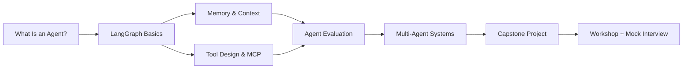
### Danh sách bài học
| # | Bài | Chủ đề chính |
| --- | --- | --- |
| 1 | What Is an AI Agent? | Định nghĩa, core components, agent paradigms, landscape 2026 |
| 2 | Building Agents với LangGraph | State, Nodes, Edges, tool execution loop, HITL |
| 3 | Agent Memory & Context Engineering | Memory types, management strategies, context compression |
| 4 | Agentic Tool Design & Integration | Tool design, tool selection, security, MCP |
| 5 | Agent Evaluation & Observability | Eval dimensions, methodologies, LangSmith/LangFuse |
| 6 | Multi-Agent Systems | Patterns, framework comparison, hands-on |
| 7 | Capstone: Vietnamese Research Assistant | Planner/Researcher/Analyzer/Writer, custom MCP server |
| 8 | Workshop + Mock Interview | Capstone showcase, guest speaker |
## Framework tư duy: Khi nào cần Agent?
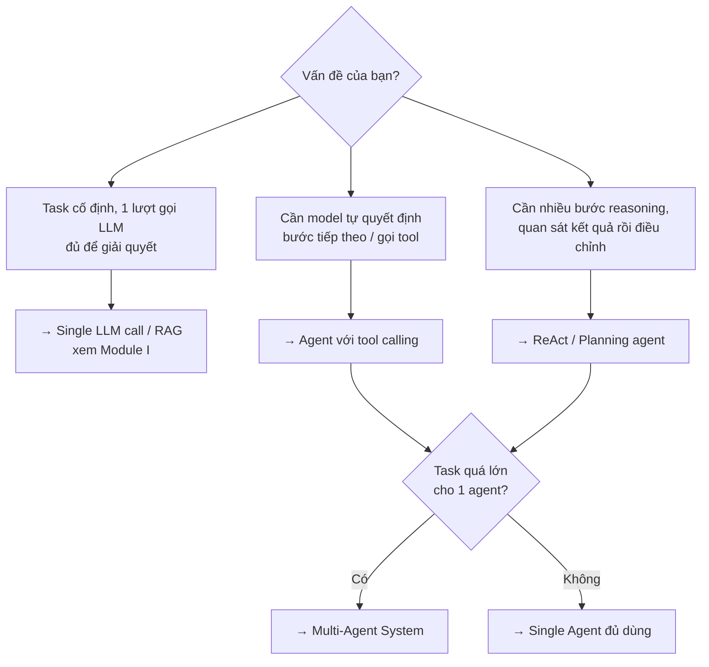
Agent không phải lúc nào cũng là câu trả lời đúng. Nếu task có thể giải quyết bằng một lời gọi LLM cố định (không cần model tự quyết định bước tiếp theo), đừng dùng agent - độ trễ cao hơn, chi phí cao hơn, và khó debug hơn nhiều so với pipeline tuyến tính.
## Phụ thuộc từ Module I
Module II xây dựng trực tiếp trên nền tảng Module I:
- **RAG Pipeline** và **Vector DB** trở thành một **tool** mà agent có thể gọi, thay vì một pipeline cố định.
- **Function Calling** là nền tảng của tool calling trong agent.
- **Evaluation & Guardrails** mở rộng sang đánh giá cả **trajectory** (chuỗi hành động), không chỉ output cuối.
- Capstone của Module II (Vietnamese Research Assistant) tái sử dụng vector store từ capstone Module I (Vietnamese Legal Assistant) như một retrieval tool cho agent Researcher.
# Bài 1: What Is an AI Agent?
## Tổng quan
Bài này xây dựng nền tảng khái niệm cho toàn bộ Module II: agent là gì, khác gì với một lời gọi LLM đơn thuần hay một RAG pipeline cố định, các thành phần cấu thành nên một agent, cách cấu trúc system prompt cho agent phức tạp, và bức tranh landscape framework/protocol năm 2026.
## 1. Định nghĩa & Sự tiến hoá
### Agent là gì?
Một **AI agent** là một hệ thống dùng LLM làm bộ não trung tâm để **tự quyết định** chuỗi hành động cần thực hiện nhằm đạt mục tiêu, thay vì đi theo một luồng xử lý cố định do lập trình viên viết sẵn.
Điểm khác biệt cốt lõi so với pipeline truyền thống: **ai quyết định bước tiếp theo**.
|  | Pipeline cố định (vd: RAG ở Module I) | Agent |
| --- | --- | --- |
| Luồng xử lý | Lập trình viên định nghĩa trước: retrieve → generate | LLM tự quyết định: cần tool nào, gọi mấy lần, khi nào dừng |
| Số bước | Cố định | Động, phụ thuộc vào kết quả trung gian |
| Khả năng phục hồi lỗi | Không - nếu retrieve rỗng, generate vẫn chạy | Có thể quan sát lỗi và thử cách khác |
RAG có phải là agent không?
RAG cơ bản (retrieve → generate) **không phải** agent - đó là pipeline cố định. Agentic RAG (Module I, Bài 6) đã bắt đầu mang tính agent vì model tự quyết định có cần retrieve lại hay tìm web không. Ranh giới nằm ở **quyền tự quyết định hành động tiếp theo**.
### Sự tiến hoá
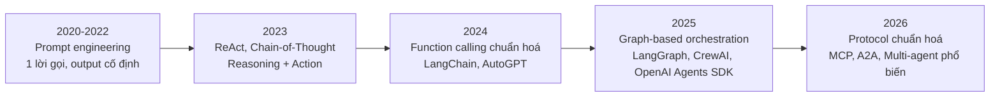
A2A là gì?
**Agent2Agent (A2A)** là chuẩn giao tiếp giữa các agent với nhau (agent-to-agent), khác với MCP vốn chuẩn hoá giao tiếp giữa agent và tool/data source. A2A liên quan trực tiếp đến Multi-Agent Systems ([Bài 6](https://handbook.yourclassacademy.com/llm-engineer/module-2/06-multi-agent/)) nhưng nằm ngoài phạm vi module này - chỉ nhắc đến ở đây để định vị trong bức tranh landscape.
## 2. Core Components
Mọi agent, dù dùng framework nào, đều gồm 4 thành phần:
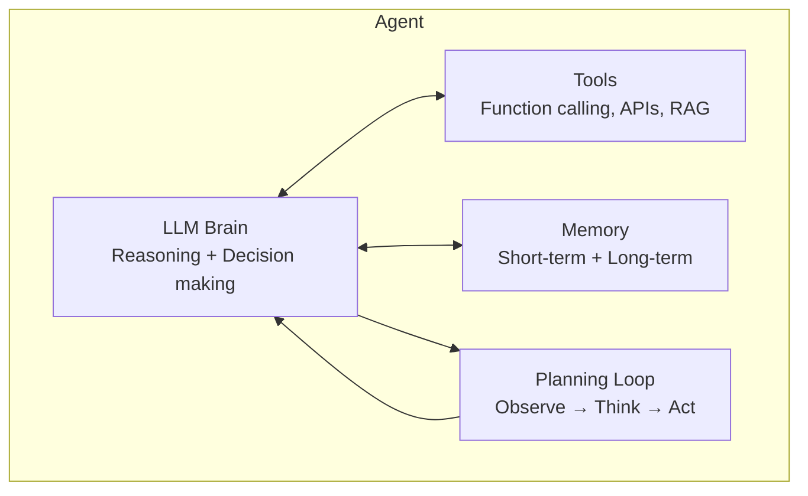
| Thành phần | Vai trò | Ví dụ |
| --- | --- | --- |
| **LLM Brain** | Reasoning, ra quyết định, chọn hành động tiếp theo | GPT-4o, Claude, Gemini |
| **Tools** | Cầu nối với thế giới bên ngoài | Web search, database query, RAG retrieval, code execution |
| **Memory** | Giữ ngữ cảnh qua nhiều bước / nhiều lượt hội thoại | Conversation history, vector store, scratchpad |
| **Planning Loop** | Vòng lặp quan sát - suy nghĩ - hành động, quyết định khi nào dừng | ReAct loop, task decomposition |
Thiếu 1 thành phần vẫn có thể gọi là agent, nhưng giới hạn
Một chatbot chỉ có LLM Brain + Memory (không có Tools) chỉ có thể trò chuyện, không thể hành động. Một script gọi tool cố định (không có Planning Loop) là automation, không phải agent thực sự.
## 3. System Prompt: Cấu trúc & Cách lắp ráp
System prompt là nơi cấu hình "LLM Brain" - agent càng phức tạp, system prompt càng cần được **lắp ráp có cấu trúc** thay vì viết tay một đoạn văn dài.
### 6 tầng của một system prompt
| Tầng | Trả lời câu hỏi | Ví dụ |
| --- | --- | --- |
| **Identity** | Agent là ai? | "Bạn là trợ lý kỹ thuật cấp cao chuyên về..." |
| **Constraints** | Luôn/không bao giờ làm gì? | "Không bao giờ thực thi lệnh phá huỷ dữ liệu mà chưa xác nhận" |
| **Capabilities** | Có tool gì? | Mô tả + schema của các tool khả dụng |
| **Context** | Môi trường hiện tại? | Thư mục làm việc, trạng thái git, thời gian |
| **Behavior** | Cư xử thế nào? | Tone, độ dài phản hồi, phong cách ra quyết định |
| **Knowledge** | Kiến thức chuyên biệt? | Skill instructions, memory liên quan (Bài 3) |
### Lắp ráp theo từng phần, không viết 1 khối văn bản
```python
def assemble_system_prompt(agent_config: dict, task: str, environment: dict) -> str:
    sections = []
    sections.append(agent_config["identity"])       # Luôn có
    sections.append(agent_config["constraints"])     # Luôn có
    sections.append(format_tools(select_tools(task, agent_config["tools"])))  # Lọc theo task
    sections.append(format_environment(environment)) # Động, theo runtime
    if agent_config.get("soul"):
        sections.append(agent_config["soul"])         # Behavior, xem SOUL.md bên dưới
    return "\n\n".join(sections)
```
Anti-pattern: nhồi tất cả vào 1 chuỗi
Viết system prompt như 1 đoạn văn dài chứa mọi thứ (identity + toàn bộ 50 tool + toàn bộ lịch sử user + 200 skill) không maintain được, không customize được theo task, và lãng phí token nghiêm trọng. Luôn lắp ráp từ các phần nhỏ, lọc theo nhu cầu hiện tại - giống cách JIT tool loading lọc tool theo task ([Bài 4](https://handbook.yourclassacademy.com/llm-engineer/module-2/04-tool-design/)).
### [AGENTS.md](http://AGENTS.md) vs [SOUL.md](http://SOUL.md): tách "làm gì" khỏi "là ai"
Với agent cá nhân hoá (vd: trợ lý dùng lâu dài, nhớ user qua nhiều session - Bài 3), tách system prompt thành 2 file riêng biệt giúp thay đổi tính cách mà không đụng vào logic vận hành, và ngược lại:
| File | Trả lời | Ví dụ nội dung |
| --- | --- | --- |
| [**AGENTS.md**](http://AGENTS.md) | Agent \*làm gì\*, quy tắc vận hành | "Dùng `web_search` cho câu hỏi thực tế. Luôn xác nhận trước khi xoá dữ liệu." |
| [**SOUL.md**](http://SOUL.md) | Agent \*cư xử ra sao\*, tính cách | "Trả lời trực tiếp rồi mới giải thích. Thừa nhận khi không chắc thay vì bịa." |
```javascript
# AGENTS.md (vận hành - developer sở hữu)
## Quy tắc công cụ
- Dùng `search_vietnamese_news` cho câu hỏi thời sự
- Luôn xác nhận trước khi gọi tool có side effect

# SOUL.md (tính cách - user tuỳ chỉnh)
## Phong cách giao tiếp
- Trả lời ngắn gọn, đi thẳng vào trọng tâm
- Dùng ví dụ cụ thể thay vì giải thích trừu tượng
```
**Lợi ích:** User đổi tông giọng agent ([SOUL.md](http://SOUL.md)) mà không sợ phá vỡ logic vận hành ([AGENTS.md](http://AGENTS.md)); developer thêm tool/quy tắc mới mà không ảnh hưởng tính cách đã được user tuỳ chỉnh.
Chỉ cần tách khi agent thực sự cá nhân hoá lâu dài
Với agent dùng 1 lần hoặc task-specific (đa số ví dụ trong module này), 1 system prompt đơn giản là đủ. Tách [AGENTS.md/SOUL.md](http://AGENTS.md/SOUL.md) đáng giá khi agent phục vụ nhiều user với gu cá nhân khác nhau, hoặc khi đội ngũ vận hành và đội ngũ thiết kế trải nghiệm là 2 nhóm khác nhau.
## 4. Agent Paradigms
### Reflex Agent
Phản ứng trực tiếp với input hiện tại, không có bộ nhớ về quá khứ, không lập kế hoạch nhiều bước.
```python
def reflex_agent(user_input: str) -> str:
    # Map input → action, không suy luận nhiều bước
    if "thời tiết" in user_input:
        return get_weather()
    if "giá vàng" in user_input:
        return get_gold_price()
    return llm_respond(user_input)
```
**Phù hợp khi:** Task đơn giản, 1 bước, không cần ngữ cảnh trước đó.
### Planning Agent
Trước khi hành động, agent **lập kế hoạch** toàn bộ các bước cần làm, rồi thực thi theo kế hoạch (có thể điều chỉnh khi gặp lỗi).
```javascript
PLAN_PROMPT = """Nhiệm vụ: {task}

Hãy lập kế hoạch các bước cần thực hiện để hoàn thành nhiệm vụ.
Trả về danh sách bước theo thứ tự, mỗi bước là 1 hành động cụ thể.
"""

# LLM trả về:
# 1. Tìm kiếm thông tin về công ty X
# 2. Tổng hợp báo cáo tài chính quý gần nhất
# 3. So sánh với đối thủ cạnh tranh
# 4. Viết báo cáo tổng hợp
```
**Phù hợp khi:** Task phức tạp, nhiều bước phụ thuộc lẫn nhau, cần nhìn toàn cảnh trước khi hành động (vd: research agent trong capstone).
### ReAct (Reasoning + Acting)
Xen kẽ giữa **suy nghĩ** (Thought), **hành động** (Action), và **quan sát** (Observation) - mỗi bước phụ thuộc vào kết quả của bước trước, thay vì lập kế hoạch toàn bộ ngay từ đầu.
```javascript
Thought: Cần biết giá cổ phiếu VNM hôm nay để trả lời câu hỏi.
Action: get_stock_price("VNM")
Observation: VNM: 68,500 VNĐ (+1.2%)
Thought: Đã có giá. Giờ cần biết vốn hoá thị trường để so sánh.
Action: get_market_cap("VNM")
Observation: Vốn hoá: 142,000 tỷ VNĐ
Thought: Đã đủ thông tin để trả lời.
Final Answer: Cổ phiếu VNM hôm nay giao dịch ở mức 68,500 VNĐ (+1.2%)...
```
```python
from openai import OpenAI

client = OpenAI()

REACT_SYSTEM_PROMPT = """Bạn giải quyết task bằng vòng lặp Thought/Action/Observation.
Sau mỗi Observation, quyết định: cần Action tiếp theo, hay đã đủ để đưa Final Answer.
Không lập kế hoạch trước - suy nghĩ từng bước dựa trên thông tin quan sát được."""

def react_loop(task: str, tools: dict, max_steps: int = 6):
    messages = [
        {"role": "system", "content": REACT_SYSTEM_PROMPT},
        {"role": "user", "content": task},
    ]
    for step in range(max_steps):
        response = client.chat.completions.create(
            model="gpt-4o-mini", messages=messages, tools=tools["schema"]
        )
        msg = response.choices[0].message
        if msg.tool_calls:
            messages.append(msg)
            for call in msg.tool_calls:
                result = tools["execute"](call)
                messages.append({
                    "role": "tool", "tool_call_id": call.id, "content": str(result)
                })
        else:
            return msg.content  # Final Answer
    return "Vượt quá số bước cho phép."
```
**Phù hợp khi:** Không biết trước cần bao nhiêu bước hoặc tool nào; mỗi bước phụ thuộc kết quả quan sát trước đó (vd: debug lỗi, multi-hop question answering).
### So sánh 3 paradigms
| Paradigm | Có bộ nhớ nhiều bước? | Lập kế hoạch trước? | Độ phức tạp task phù hợp |
| --- | --- | --- | --- |
| **Reflex** | Không | Không | Thấp - 1 bước |
| **Planning** | Có | Có, toàn bộ trước khi chạy | Cao - nhiều bước độc lập, biết trước cấu trúc |
| **ReAct** | Có | Không, từng bước một | Cao - nhiều bước phụ thuộc kết quả trung gian |
LangGraph hỗ trợ cả 3 paradigm
Bài 2 sẽ dùng LangGraph để implement ReAct loop bằng state graph - đây là paradigm phổ biến nhất cho agent thực tế vì cân bằng giữa tính linh hoạt và khả năng kiểm soát.
## 5. Landscape 2026
### Framework so sánh
| Framework | Điểm mạnh | Điểm yếu | Dùng khi |
| --- | --- | --- | --- |
| **LangGraph** | Kiểm soát chi tiết state/flow, debug tốt, tích hợp LangSmith | Đường cong học tập cao hơn | Cần custom logic phức tạp, production-grade |
| **CrewAI** | API cấp cao, dễ setup multi-agent theo "role" | Ít linh hoạt khi cần custom control flow | Prototype nhanh, team-based agents |
| **AutoGen** | Mạnh về multi-agent conversation, research-oriented | Ít structured hơn cho production | Nghiên cứu, agent hội thoại phức tạp |
| **OpenAI Agents SDK** | Tích hợp chặt với OpenAI models, đơn giản | Gắn với hệ sinh thái OpenAI | Dự án dùng OpenAI làm nhà cung cấp chính |
Vì sao Module này chọn LangGraph làm mặc định
LangGraph biểu diễn agent như một **state graph** tường minh - mỗi node, edge, điều kiện rẽ nhánh đều là code bạn kiểm soát hoàn toàn. Điều này giúp debug, test, và mở rộng sang multi-agent dễ dàng hơn so với các framework "hộp đen" cấp cao. Các framework khác sẽ được nhắc đến trong bảng so sánh khi liên quan (Bài 6).
### MCP (Model Context Protocol)
MCP là chuẩn mở (do Anthropic khởi xướng, nay được nhiều provider hỗ trợ) để kết nối agent với tools/data sources một cách thống nhất - thay vì mỗi tool cần một tích hợp riêng.
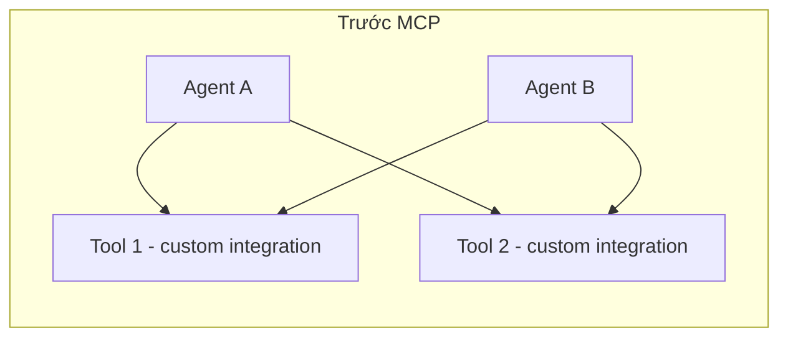
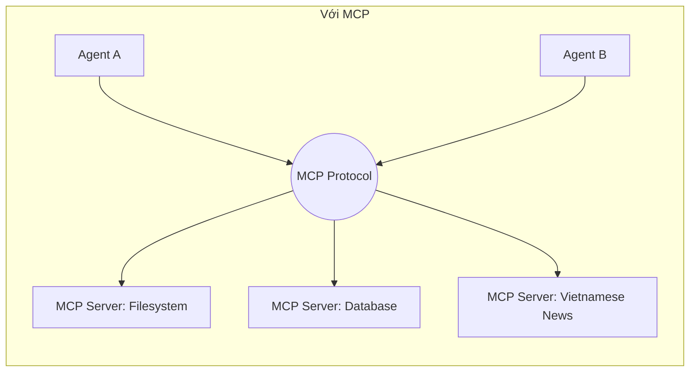
MCP sẽ được đào sâu ở Bài 4 (chuẩn giao tiếp, cách viết Server/Client) - phần này chỉ giới thiệu vị trí của nó trong landscape: MCP giải quyết bài toán **N agent × M tool = N×M integration** bằng cách chuẩn hoá thành **N + M**.
## Tóm tắt
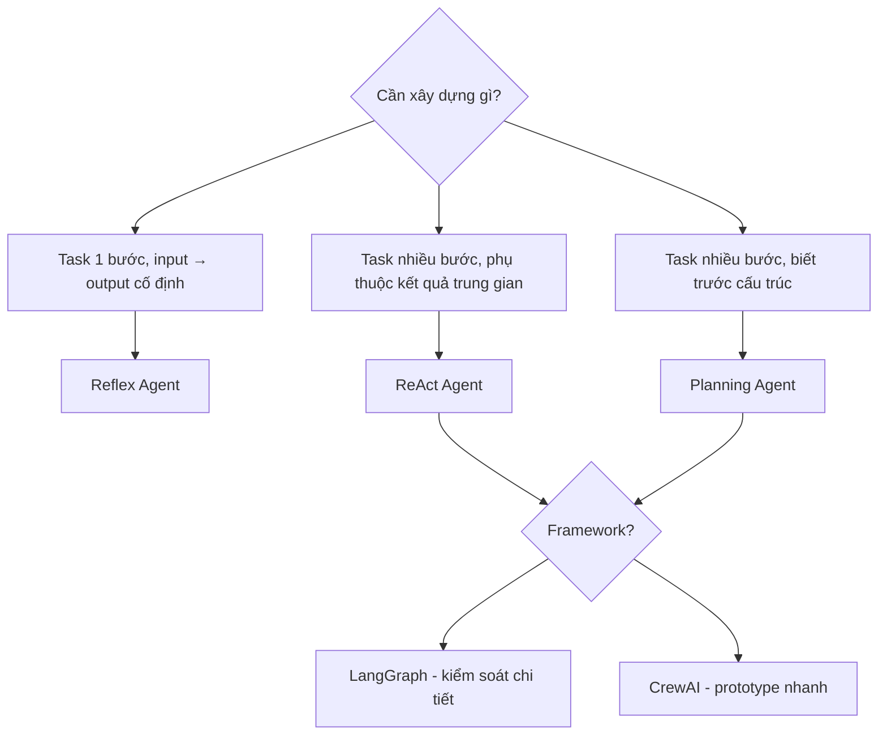
| Khái niệm | Ghi nhớ |
| --- | --- |
| Agent vs Pipeline | Ai quyết định bước tiếp theo: code cố định hay LLM? |
| Core components | Brain + Tools + Memory + Planning Loop |
| System prompt | Lắp ráp từ 6 tầng, lọc theo task - không viết 1 khối văn bản |
| [AGENTS.md](http://AGENTS.md) / [SOUL.md](http://SOUL.md) | Tách "làm gì" (vận hành) khỏi "là ai" (tính cách) |
| Reflex | 1 bước, không nhớ, không lập kế hoạch |
| Planning | Lập kế hoạch toàn bộ trước khi thực thi |
| ReAct | Suy nghĩ - Hành động - Quan sát, lặp lại |
| MCP | Chuẩn hoá kết nối agent ↔ tool, tránh N×M integration |
# Bài 2: Building Agents với LangGraph
## Tổng quan
Bài này trang bị kỹ năng xây dựng agent bằng LangGraph: biểu diễn agent như một state graph, xây dựng tool execution loop, biết khi nào dừng và phục hồi khi tool lỗi, tách biệt lập kế hoạch khỏi hành động, giữ trạng thái qua nhiều lượt hội thoại, và chèn con người vào vòng lặp khi cần phê duyệt hành động nhạy cảm.
## 1. State, Nodes, Edges
LangGraph biểu diễn agent như một **đồ thị có hướng**: mỗi bước xử lý là một **node**, luồng di chuyển giữa các bước là **edge**, và toàn bộ dữ liệu được chia sẻ qua các node là **state**.
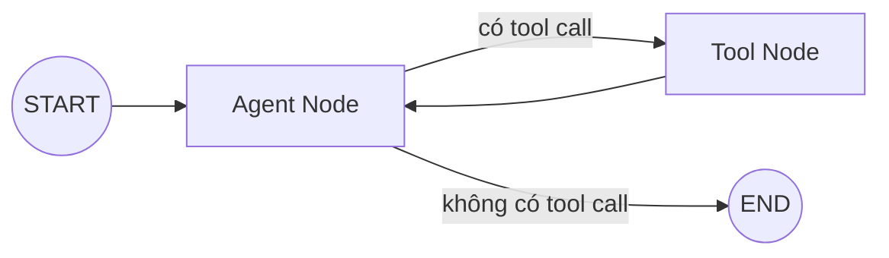
### State
State là một `TypedDict` (hoặc Pydantic model) mô tả dữ liệu được truyền và cập nhật xuyên suốt graph.
```python
from typing import TypedDict, Annotated
from langgraph.graph.message import add_messages

class AgentState(TypedDict):
    messages: Annotated[list, add_messages]  # tự động append thay vì overwrite
    step_count: int
```
`Annotated[list, add_messages]` là gì?
Mặc định, khi một node trả về `{"messages": [...]}`, LangGraph sẽ **ghi đè** giá trị cũ. Dùng `add_messages` (reducer function) để thay vào đó **nối thêm** message mới vào danh sách - cần thiết để giữ lịch sử hội thoại qua nhiều bước.
### Nodes
Node là một hàm Python nhận `state` hiện tại, trả về phần state cần cập nhật.
```python
from langchain_openai import ChatOpenAI

llm = ChatOpenAI(model="gpt-4o-mini")

def agent_node(state: AgentState) -> dict:
    response = llm.invoke(state["messages"])
    return {"messages": [response], "step_count": state["step_count"] + 1}
```
### Edges
Edge nối 2 node theo một chiều cố định. **Conditional edge** chọn node tiếp theo dựa trên logic (thường dựa trên state hiện tại).
```python
from langgraph.graph import StateGraph, START, END

def should_continue(state: AgentState) -> str:
    last_message = state["messages"][-1]
    if last_message.tool_calls:
        return "tools"
    return END

graph = StateGraph(AgentState)
graph.add_node("agent", agent_node)
graph.add_edge(START, "agent")
graph.add_conditional_edges("agent", should_continue, {"tools": "tools", END: END})
```
## 2. Tool Nodes & Tool Execution Loop
### Định nghĩa tools
```python
from langchain_core.tools import tool

@tool
def search_vietnamese_news(query: str) -> str:
    """Tìm kiếm tin tức tiếng Việt mới nhất theo từ khoá."""
    # Gọi API thực tế ở đây
    return f"Kết quả tìm kiếm cho '{query}': ..."

@tool
def get_stock_price(symbol: str) -> str:
    """Lấy giá cổ phiếu hiện tại theo mã chứng khoán (vd: VNM, FPT)."""
    return f"{symbol}: 68,500 VNĐ (+1.2%)"

tools = [search_vietnamese_news, get_stock_price]
llm_with_tools = llm.bind_tools(tools)
```
### Tool Node - dùng ToolNode có sẵn
LangGraph cung cấp `ToolNode` để tự động thực thi tool calls mà không cần viết logic parse JSON thủ công (như ở Module I, Bài 1).
```python
from langgraph.prebuilt import ToolNode

tool_node = ToolNode(tools)

def agent_node(state: AgentState) -> dict:
    response = llm_with_tools.invoke(state["messages"])
    return {"messages": [response]}

def should_continue(state: AgentState) -> str:
    last_message = state["messages"][-1]
    return "tools" if last_message.tool_calls else END

graph = StateGraph(AgentState)
graph.add_node("agent", agent_node)
graph.add_node("tools", tool_node)
graph.add_edge(START, "agent")
graph.add_conditional_edges("agent", should_continue, {"tools": "tools", END: END})
graph.add_edge("tools", "agent")  # Vòng lặp: sau khi chạy tool, quay lại agent

app = graph.compile()
```
### Chạy thử
```python
result = app.invoke({
    "messages": [{"role": "user", "content": "Giá cổ phiếu FPT hôm nay bao nhiêu?"}],
    "step_count": 0,
})
print(result["messages"][-1].content)
```
Đây chính là **ReAct loop** (Bài 1) được biểu diễn bằng graph: `agent → tools → agent → ... → END` cho đến khi model không còn gọi tool nữa.
Luôn giới hạn số vòng lặp
Nếu model liên tục gọi tool (vd: do tool trả về lỗi mà model không nhận ra), graph có thể lặp vô hạn. Thêm giới hạn qua `recursion_limit` khi invoke: `app.invoke(input, config={"recursion_limit": 15})`.
## 3. Loop Termination & Error Recovery
### Agent biết dừng khi nào?
Đây là câu hỏi tưởng đơn giản nhưng dễ bị bỏ qua - agent không dừng đúng lúc vừa tốn chi phí vừa có thể gây hại nếu tiếp tục hành động ngoài ý muốn.
| Chiến lược | Cách hoạt động | Khi nào dùng |
| --- | --- | --- |
| **Model tự quyết định** | Model ngừng gọi tool, trả text - cách mặc định ở Bài 2 mục 2 | Luôn có, là cơ chế cơ bản nhất |
| **Max steps** | Giới hạn cứng số vòng lặp (`recursion_limit`) | Luôn thêm làm lưới an toàn |
| **Explicit stop tool** | Agent phải gọi tool `final_answer`/`submit` để hoàn thành | Task cần xác nhận rõ ràng đã xong (vd: coding agent) |
| **Goal verification** | Một lời gọi LLM riêng kiểm tra xem mục tiêu đã đạt chưa | Task quan trọng, cần double-check trước khi trả kết quả |
| **Cost/token budget** | Dừng khi vượt ngân sách token/chi phí | Production, cần kiểm soát chi phí chặt |
```python
@tool
def final_answer(answer: str) -> str:
    """Nộp câu trả lời cuối cùng. Chỉ gọi tool này khi đã hoàn thành nhiệm vụ."""
    return answer

def should_continue(state: AgentState) -> str:
    last_message = state["messages"][-1]
    if not last_message.tool_calls:
        return END
    # Nếu tool call là final_answer, dừng graph dù về mặt kỹ thuật vẫn là tool call
    if last_message.tool_calls[0]["name"] == "final_answer":
        return END
    return "tools"
```
### Đưa lỗi tool ngược lại cho model, đừng giấu
Khi tool thất bại, **đừng** raise exception làm crash graph - trả lỗi dưới dạng tool message để model tự điều chỉnh cách tiếp cận (đã nói ở Bài 4 mục 1, nhắc lại vì đây là phần cốt lõi của vòng lặp).
```python
def tool_node_with_recovery(state: AgentState) -> dict:
    last_message = state["messages"][-1]
    results = []
    for call in last_message.tool_calls:
        try:
            output = execute_tool(call)
        except Exception as e:
            # Lỗi trở thành 1 quan sát bình thường, không phải crash
            output = f"LỖI: {e}. Hãy thử cách tiếp cận khác."
        results.append({"role": "tool", "tool_call_id": call["id"], "content": str(output)})
    return {"messages": results}
```
Model hiện đại tự điều chỉnh tốt khi thấy lỗi
Đừng che giấu lỗi khỏi model bằng cách retry âm thầm hoặc trả về giá trị mặc định. Model đủ mạnh để đọc thông báo lỗi và tự thử hướng khác - đây chính là bản chất "tự sửa lỗi" của vòng lặp ReAct.
### Phát hiện vòng lặp
Nếu agent lặp lại cùng 1 hành động nhiều lần liên tiếp, đó là dấu hiệu agent bị kẹt - cần can thiệp thay vì để `recursion_limit` âm thầm cắt ngang.
```python
def detect_repetition(state: AgentState, window: int = 4) -> bool:
    """Kiểm tra xem N tool call gần nhất có bị lặp lại giống hệt không."""
    recent_calls = [
        m.tool_calls[0] for m in state["messages"][-window:]
        if hasattr(m, "tool_calls") and m.tool_calls
    ]
    if len(recent_calls) < window:
        return False
    return len(set(str(c) for c in recent_calls)) == 1  # Tất cả giống nhau

def agent_node_with_loop_check(state: AgentState) -> dict:
    if detect_repetition(state):
        return {"messages": [{
            "role": "system",
            "content": "Bạn đang lặp lại cùng 1 hành động. Hãy thử cách tiếp cận hoàn toàn khác.",
        }]}
    response = llm_with_tools.invoke(state["messages"])
    return {"messages": [response]}
```
## 4. Plan/Act Separation
### Vấn đề: hành động trước khi hiểu rõ
Lỗi phổ biến nhất của agent là **lao vào hành động trước khi hiểu đủ vấn đề** - sửa nhầm chỗ, edit file không cần thiết, hoặc bỏ sót ngữ cảnh quan trọng. Cline (VS Code agent) giải quyết bằng cách tách rõ 2 chế độ.
| Chế độ | Được phép làm | Không được phép |
| --- | --- | --- |
| **Plan Mode** | Đọc file, tìm kiếm codebase, phân tích, tạo kế hoạch từng bước | Sửa file, chạy lệnh, tạo/xoá file |
| **Act Mode** | Toàn bộ tool, thực thi theo kế hoạch đã duyệt | - |
Plan Mode buộc agent hiểu trước khi hành động; user review và duyệt kế hoạch trước khi chuyển sang Act Mode - nơi mọi hành động có side effect mới được phép chạy.
### Implement bằng LangGraph: giới hạn tool theo phase
```python
from typing import TypedDict, Annotated, Literal
from langgraph.graph.message import add_messages

class PlanActState(TypedDict):
    messages: Annotated[list, add_messages]
    mode: Literal["plan", "act"]
    plan: str

READ_ONLY_TOOLS = [read_file, search_codebase, list_directory]
ALL_TOOLS = READ_ONLY_TOOLS + [edit_file, run_command, delete_file]

def plan_node(state: PlanActState) -> dict:
    """Chỉ dùng tool đọc - không có side effect."""
    llm_plan = llm.bind_tools(READ_ONLY_TOOLS)
    response = llm_plan.invoke(
        [{"role": "system", "content": "Phân tích yêu cầu và tạo kế hoạch từng bước. "
                                        "KHÔNG sửa file hay chạy lệnh - chỉ đọc và phân tích."}]
        + state["messages"]
    )
    return {"messages": [response]}

def act_node(state: PlanActState) -> dict:
    """Toàn quyền tool, chỉ chạy sau khi user duyệt plan."""
    llm_act = llm.bind_tools(ALL_TOOLS)
    response = llm_act.invoke(
        [{"role": "system", "content": f"Thực thi theo kế hoạch đã duyệt:\n{state['plan']}"}]
        + state["messages"]
    )
    return {"messages": [response]}

def route_by_mode(state: PlanActState) -> str:
    return "plan" if state["mode"] == "plan" else "act"
```
Kết hợp với HITL (mục 6) - `interrupt_before` giữa 2 phase để user review kế hoạch trước khi cho phép chuyển sang Act Mode - đây là ứng dụng cụ thể của HITL cho toàn bộ 1 giai đoạn, không chỉ 1 tool call.
Tách Plan/Act là quyết định kiến trúc, không chỉ prompt
Chỉ dặn model "hãy lập kế hoạch trước" trong system prompt (implicit planning, Bài 1) không đủ tin cậy - model vẫn có thể lẫn lộn giữa suy nghĩ và hành động. Giới hạn **tool khả dụng theo từng node** như trên mới đảm bảo được ranh giới cứng giữa 2 giai đoạn.
## 5. Memory & State Persistence
### Checkpointer - lưu state giữa các lượt gọi
Mặc định, state chỉ tồn tại trong một lần `invoke()`. Để agent "nhớ" hội thoại qua nhiều lượt (nhiều lần gọi `invoke` khác nhau), dùng **checkpointer**.
```python
from langgraph.checkpoint.memory import MemorySaver

checkpointer = MemorySaver()
app = graph.compile(checkpointer=checkpointer)

config = {"configurable": {"thread_id": "user-123"}}

# Lượt 1
app.invoke({"messages": [{"role": "user", "content": "Tôi tên Minh."}]}, config=config)

# Lượt 2 - agent vẫn nhớ "Minh" nhờ cùng thread_id
result = app.invoke({"messages": [{"role": "user", "content": "Tôi tên gì?"}]}, config=config)
print(result["messages"][-1].content)  # "Bạn tên Minh."
```
`thread_id` phân biệt các cuộc hội thoại độc lập - mỗi user/session dùng một `thread_id` riêng.
### Persistent checkpointer cho production
`MemorySaver` chỉ lưu trong RAM, mất khi restart. Production cần checkpointer bền vững:
```python
from langgraph.checkpoint.sqlite import SqliteSaver

with SqliteSaver.from_conn_string("checkpoints.db") as checkpointer:
    app = graph.compile(checkpointer=checkpointer)
```
Checkpointer khác Memory ở Bài 3
Checkpointer lưu **toàn bộ state của graph** (để resume/replay execution) - đây là cơ chế kỹ thuật của LangGraph. Bài 3 (Agent Memory) nói về **thiết kế những gì agent nên nhớ** (short-term, long-term, episodic...) - một bài toán ở tầng cao hơn, thường xây trên nền checkpointer này.
## 6. Human-in-the-Loop
Với hành động nhạy cảm (xoá dữ liệu, gửi email, giao dịch tài chính), cần con người phê duyệt trước khi agent thực thi.
### Interrupt trước khi gọi tool
```python
app = graph.compile(checkpointer=checkpointer, interrupt_before=["tools"])

config = {"configurable": {"thread_id": "session-1"}}
result = app.invoke(
    {"messages": [{"role": "user", "content": "Huỷ đơn hàng #4521 giúp tôi."}]},
    config=config,
)
# Graph dừng lại TRƯỚC khi chạy tool node

# Kiểm tra tool call agent định thực hiện
pending_call = result["messages"][-1].tool_calls[0]
print(f"Agent muốn gọi: {pending_call['name']}({pending_call['args']})")

# Con người phê duyệt → resume graph bằng cách invoke với input=None
if user_approves:
    final_result = app.invoke(None, config=config)
else:
    # Từ chối: inject message huỷ bỏ rồi tiếp tục
    pass
```
### Chỉnh sửa state trước khi resume
```python
# Con người có thể sửa state trước khi cho graph tiếp tục
app.update_state(config, {"messages": [{"role": "user", "content": "Chỉ huỷ nếu chưa giao hàng."}]})
final_result = app.invoke(None, config=config)
```
HITL cần checkpointer
`interrupt_before` / `interrupt_after` chỉ hoạt động khi graph được compile với checkpointer - vì graph cần lưu state tại điểm dừng để resume sau này.
## 7. Hands-on: Vietnamese Personal Assistant
Kết hợp toàn bộ: tool calling + memory + HITL cho một trợ lý cá nhân tiếng Việt.
```python
from typing import TypedDict, Annotated
from langgraph.graph import StateGraph, START, END
from langgraph.graph.message import add_messages
from langgraph.prebuilt import ToolNode
from langgraph.checkpoint.memory import MemorySaver
from langchain_openai import ChatOpenAI
from langchain_core.tools import tool

# ====== STATE ======
class AssistantState(TypedDict):
    messages: Annotated[list, add_messages]

# ====== TOOLS ======
@tool
def check_calendar(date: str) -> str:
    """Kiểm tra lịch làm việc theo ngày (định dạng YYYY-MM-DD)."""
    return f"Ngày {date}: 14h họp team, 16h30 gọi khách hàng."

@tool
def send_reminder(message: str, time: str) -> str:
    """Đặt lời nhắc. Hành động này cần con người phê duyệt trước khi gửi."""
    return f"Đã đặt lời nhắc '{message}' lúc {time}."

@tool
def search_restaurant(location: str, cuisine: str = "") -> str:
    """Tìm nhà hàng theo khu vực và loại món ăn."""
    return f"3 nhà hàng {cuisine} gần {location}: Quán A, Quán B, Quán C."

tools = [check_calendar, send_reminder, search_restaurant]

# ====== LLM ======
llm = ChatOpenAI(model="gpt-4o-mini", temperature=0.2)
llm_with_tools = llm.bind_tools(tools)

SYSTEM_PROMPT = """Bạn là trợ lý cá nhân tiếng Việt, thân thiện và ngắn gọn.
Dùng tool khi cần thông tin lịch, đặt lời nhắc, hoặc tìm nhà hàng."""

# ====== NODES ======
def agent_node(state: AssistantState) -> dict:
    messages = [{"role": "system", "content": SYSTEM_PROMPT}] + state["messages"]
    response = llm_with_tools.invoke(messages)
    return {"messages": [response]}

def should_continue(state: AssistantState) -> str:
    last_message = state["messages"][-1]
    return "tools" if last_message.tool_calls else END

# ====== BUILD GRAPH ======
graph = StateGraph(AssistantState)
graph.add_node("agent", agent_node)
graph.add_node("tools", ToolNode(tools))
graph.add_edge(START, "agent")
graph.add_conditional_edges("agent", should_continue, {"tools": "tools", END: END})
graph.add_edge("tools", "agent")

checkpointer = MemorySaver()
assistant = graph.compile(
    checkpointer=checkpointer,
    interrupt_before=["tools"],  # Phê duyệt trước khi gọi bất kỳ tool nào
)

# ====== CHẠY ======
config = {"configurable": {"thread_id": "user-minh"}}

result = assistant.invoke(
    {"messages": [{"role": "user", "content": "Chiều nay tôi có lịch gì không?"}]},
    config=config,
)

# Graph dừng trước tool call - hiển thị cho user xác nhận
last_msg = result["messages"][-1]
if last_msg.tool_calls:
    call = last_msg.tool_calls[0]
    print(f"Trợ lý muốn: {call['name']}({call['args']}) - Đồng ý? (y/n)")
    # Giả sử user đồng ý:
    final = assistant.invoke(None, config=config)
    print(final["messages"][-1].content)
```
## Tóm tắt
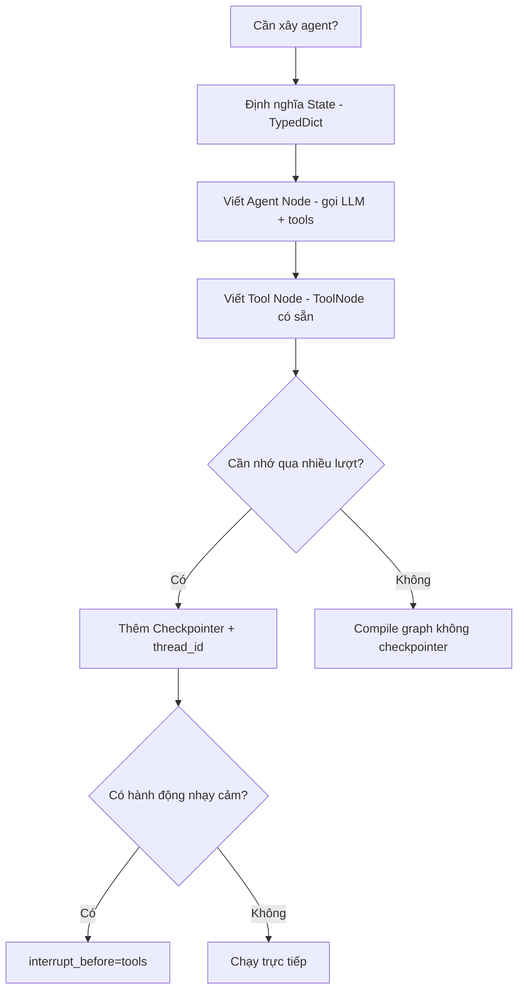
| Thành phần | Vai trò | API chính |
| --- | --- | --- |
| State | Dữ liệu chia sẻ giữa các node | `TypedDict`  • `Annotated[list, add_messages]` |
| Node | Đơn vị xử lý (agent, tool) | Hàm nhận state, trả dict cập nhật |
| Conditional edge | Rẽ nhánh dựa trên state | `add_conditional_edges` |
| ToolNode | Tự động thực thi tool calls | `langgraph.prebuilt.ToolNode` |
| Loop termination | Model tự dừng, max steps, explicit stop tool, goal verification | `recursion_limit`, tool `final_answer` |
| Error recovery | Trả lỗi tool về dạng model đọc được, không raise | try/except trong tool node |
| Plan/Act separation | Giới hạn tool theo phase để tránh hành động trước khi hiểu rõ | Node riêng + tool set riêng cho mỗi mode |
| Checkpointer | Lưu state qua nhiều lượt invoke | `MemorySaver`, `SqliteSaver` |
| HITL | Dừng để con người phê duyệt | `interrupt_before` / `interrupt_after` |
# Bài 3: Agent Memory & Context Engineering
## Tổng quan
Context window có giới hạn, nhưng agent cần hoạt động qua hàng trăm lượt hội thoại và hàng nghìn tool call. Bài này phân loại các loại bộ nhớ agent cần, chiến lược quản lý context khi nó vượt giới hạn, cách nén thông tin mà không mất ý nghĩa quan trọng, và **context rot** - hiện tượng chất lượng output suy giảm ngay cả khi context còn xa mới đầy.
## 1. Memory Types
Con người có nhiều loại trí nhớ khác nhau cho các mục đích khác nhau - agent cũng vậy.
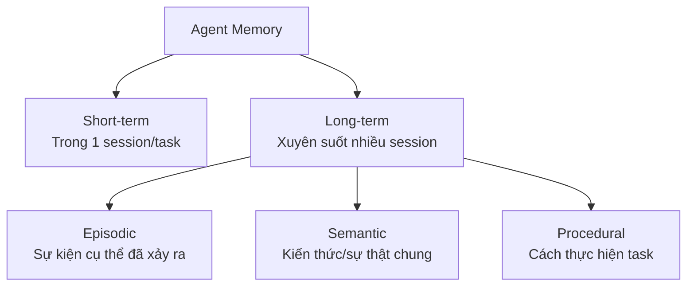
| Loại | Định nghĩa | Ví dụ | Nơi lưu trữ điển hình |
| --- | --- | --- | --- |
| **Short-term** | Ngữ cảnh của session/task hiện tại | Lịch sử hội thoại trong 1 conversation | Context window / state của graph |
| **Long-term** | Thông tin tồn tại qua nhiều session | "User tên Minh, thích nhận báo cáo dạng bullet point" | Database / vector store |
| **Episodic** | Ghi nhớ về các sự kiện/trải nghiệm cụ thể đã xảy ra | "Lần trước agent gọi tool X và bị lỗi timeout" | Log có timestamp, vector store |
| **Semantic** | Kiến thức, sự thật chung không gắn với 1 sự kiện | "Công ty TNHH tối đa 50 thành viên" | Knowledge base / RAG (Module I) |
| **Procedural** | Quy trình, cách thực hiện một loại task | "Khi user hỏi về hoá đơn, luôn check trạng thái thanh toán trước" | System prompt, few-shot examples, learned rules |
Episodic vs Semantic - phân biệt dễ nhầm
Episodic nhớ **"chuyện gì đã xảy ra"** (gắn với thời điểm cụ thể). Semantic nhớ **"sự thật là gì"** (không gắn thời điểm). "Hôm qua user phàn nàn về giao hàng chậm" là episodic. "User ở Hà Nội" là semantic.
### Ánh xạ vào LangGraph
```python
from typing import TypedDict, Annotated
from langgraph.graph.message import add_messages

class AgentState(TypedDict):
    messages: Annotated[list, add_messages]   # Short-term: hội thoại hiện tại
    user_profile: dict                         # Long-term/Semantic: nạp từ DB khi bắt đầu session
    task_history: list                         # Episodic: các task đã hoàn thành trong session
```
Long-term/Semantic/Procedural memory thường **không** sống trong graph state - chúng được đọc từ external store (database, vector store) vào đầu session, và ghi lại (nếu cần) sau khi session kết thúc.
## 2. Management Strategies
Khi hội thoại càng dài, `messages` trong state càng phình to → vượt context window, tăng chi phí, giảm độ chính xác (lost-in-the-middle). Cần chiến lược quản lý.
### Sliding Window
Chỉ giữ N message gần nhất, bỏ phần cũ hơn.
```python
def trim_messages(messages: list, max_messages: int = 20) -> list:
    if len(messages) <= max_messages:
        return messages
    # Luôn giữ system message (nếu có) + N message gần nhất
    system_msgs = [m for m in messages if m.get("role") == "system"]
    recent = messages[-max_messages:]
    return system_msgs + recent
```
**Phù hợp khi:** Hội thoại casual, thông tin cũ không còn liên quan sau vài lượt (vd: chatbot hỏi đáp đơn giản).
**Nhược điểm:** Mất hoàn toàn thông tin bị cắt - nếu user hỏi lại điều đã nói ở đầu hội thoại dài, agent "quên" thật sự.
### Summarization
Định kỳ tóm tắt phần hội thoại cũ thành 1 đoạn ngắn, thay thế toàn bộ message chi tiết.
```python
from langchain_openai import ChatOpenAI

llm = ChatOpenAI(model="gpt-4o-mini", temperature=0)

def format_messages(messages: list) -> str:
    """Chuyển list message (dict hoặc BaseMessage) thành text để đưa vào prompt."""
    lines = []
    for m in messages:
        role = m.get("role") if isinstance(m, dict) else m.type
        content = m.get("content") if isinstance(m, dict) else m.content
        lines.append(f"{role}: {content}")
    return "\n".join(lines)

def summarize_old_messages(messages: list, keep_recent: int = 6) -> list:
    if len(messages) <= keep_recent + 1:
        return messages

    old_messages = messages[:-keep_recent]
    recent_messages = messages[-keep_recent:]

    summary_prompt = f"""Tóm tắt cuộc hội thoại sau thành 3-5 câu, giữ lại thông tin quan trọng
(tên, số liệu, quyết định đã chốt, task đang làm dở):

{format_messages(old_messages)}"""

    summary = llm.invoke(summary_prompt).content

    return [{"role": "system", "content": f"[Tóm tắt hội thoại trước]: {summary}"}] + recent_messages
```
**Phù hợp khi:** Hội thoại dài nhưng có thông tin quan trọng rải rác cần giữ lại (vd: agent hỗ trợ khách hàng qua nhiều lượt).
Kết hợp trigger theo độ dài, không chạy mỗi lượt
Summarization tốn 1 lời gọi LLM - chỉ nên chạy khi `len(messages)` vượt ngưỡng (vd: \> 20 message), không chạy sau mỗi lượt hội thoại.
### Vector Memory
Lưu toàn bộ lịch sử vào vector store, chỉ **retrieve** phần liên quan đến câu hỏi hiện tại - giống RAG nhưng áp dụng cho memory thay vì tài liệu.
```python
from langchain_openai import OpenAIEmbeddings
from langchain_community.vectorstores import Chroma

embedding = OpenAIEmbeddings(model="text-embedding-3-small")
memory_store = Chroma(collection_name="agent_memory", embedding_function=embedding)

def store_memory(text: str, metadata: dict):
    memory_store.add_texts([text], metadatas=[metadata])

def retrieve_relevant_memory(query: str, k: int = 3) -> list[str]:
    results = memory_store.similarity_search(query, k=k)
    return [doc.page_content for doc in results]

# Sau mỗi lượt hội thoại quan trọng, lưu lại
store_memory(
    "User Minh làm việc tại công ty ABC, quan tâm đến báo cáo tài chính quý.",
    metadata={"user_id": "minh", "type": "semantic", "timestamp": "2026-07-15"},
)

# Khi cần, retrieve theo ngữ cảnh hiện tại thay vì load toàn bộ lịch sử
relevant = retrieve_relevant_memory("Minh cần loại báo cáo gì?")
```
**Phù hợp khi:** Long-term memory xuyên suốt nhiều session, lượng thông tin lớn, chỉ cần phần liên quan đến truy vấn hiện tại.
### Hybrid
Thực tế production thường kết hợp cả ba: sliding window cho short-term, summarization khi window đầy, vector memory cho long-term.
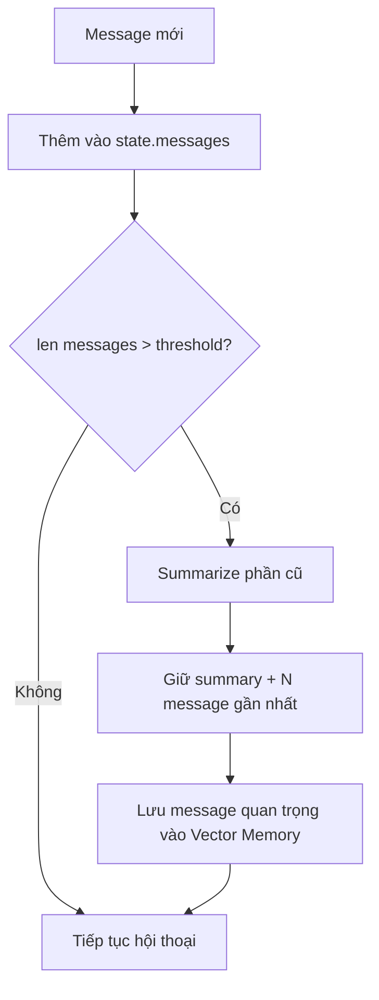
| Chiến lược | Chi phí | Mất thông tin? | Phù hợp |
| --- | --- | --- | --- |
| Sliding window | Thấp (không cần LLM call) | Có, hoàn toàn | Session ngắn, casual |
| Summarization | Trung bình (1 LLM call/lần trigger) | Một phần (nén, giữ ý chính) | Session dài, cần giữ ngữ cảnh |
| Vector memory | Trung bình (embedding + storage) | Không, nhưng cần retrieve đúng | Long-term, nhiều session |
| Hybrid | Cao nhất | Thấp nhất | Production agent phức tạp |
## 3. Context Compression
Ngoài quản lý lịch sử hội thoại, cần nén cả **kết quả tool call** - đây thường là nguồn "phình" context lớn nhất (vd: search trả về 5000 từ nhưng chỉ 2 câu liên quan).
### Nén tool output
```python
def compress_tool_result(raw_result: str, query: str, max_tokens: int = 300) -> str:
    """Tóm tắt kết quả tool trước khi đưa vào context, giữ phần liên quan đến query."""
    if len(raw_result) < max_tokens * 4:  # Ước lượng thô: 1 token ≈ 4 ký tự
        return raw_result

    compress_prompt = f"""Trích xuất thông tin liên quan đến câu hỏi từ kết quả sau.
Giữ số liệu, tên riêng chính xác. Bỏ phần không liên quan.

Câu hỏi: {query}
Kết quả thô: {raw_result[:4000]}

Thông tin liên quan (ngắn gọn):"""

    return llm.invoke(compress_prompt).content
```
### Structured over raw
Khi có thể, yêu cầu tool trả về dữ liệu có cấu trúc (JSON các trường cần thiết) thay vì raw text - giảm token và tăng độ chính xác khi model đọc lại.
```python
@tool
def search_product(query: str) -> dict:
    """Tìm sản phẩm - trả về CHỈ các trường cần thiết, không trả nguyên trang HTML."""
    raw = call_search_api(query)
    return {
        "name": raw["title"],
        "price": raw["price"],
        "in_stock": raw["stock"] > 0,
        # Bỏ: mô tả dài, review, ảnh, metadata không cần thiết
    }
```
Đừng nén quá sớm
Nén mất thông tin không thể phục hồi. Chỉ nén khi thực sự cần (gần chạm giới hạn context) hoặc khi biết chắc phần bị cắt không quan trọng cho task hiện tại. Nén quá tay là nguyên nhân phổ biến khiến agent "quên" chi tiết quan trọng.
## 4. Context Rot
Đây là "kẻ giết agent thầm lặng". Compaction (mục 2-3) giải quyết bài toán **context tràn** (vượt giới hạn window). Nhưng có một vấn đề tinh vi hơn: chất lượng output **suy giảm ngay cả khi window chưa đầy**.
### Context Rot vs Context Overflow
|  | Context Overflow | Context Rot |
| --- | --- | --- |
| **Là gì** | Context vượt giới hạn window | Chất lượng giảm dù còn trong giới hạn |
| **Khi nào** | Ở 100% dung lượng | Bắt đầu từ \~25-40% dung lượng |
| **Biểu hiện** | Lỗi / crash | Suy giảm chất lượng khó nhận ra |
| **Nhìn thấy?** | Ngay lập tức | Thường vô hình đến khi gây lỗi nghiêm trọng |
| **Cách xử lý** | Compaction (cắt/tóm tắt) | Context engineering (cấu trúc) |
Model có window 200K token vẫn có thể suy giảm ở 50K
Nghiên cứu của Chroma (2025) test 18 model frontier (GPT-4.1, Claude Opus 4, Gemini 2.5...) và phát hiện **mọi model** đều bị context rot ở mọi mức độ dài input được test. Window cho biết \*bao nhiêu token vừa\*, không cho biết \*model dùng hiệu quả được bao nhiêu\*.
### Ba cơ chế gây rot
| Cơ chế | Mô tả |
| --- | --- |
| **Lost-in-the-middle** | Model chú ý tốt phần **đầu và cuối** context, kém phần **giữa**. Thông tin quan trọng nằm giữa hội thoại dài gần như vô hình. |
| **Attention dilution** | Attention là bậc hai: càng nhiều token, "spotlight" của model càng loãng. Ở 5K token là chùm sáng tập trung; ở 100K là ánh sáng tản ra 20x diện tích. |
| **Distractor interference** | Nội dung tương tự về mặt ngữ nghĩa nhưng **không liên quan** chủ động đánh lạc hướng reasoning. Nhiễu "giống signal" tệ hơn nhiễu ngẫu nhiên. |
Ba cơ chế này **cộng hưởng nhân lên**, nên context rot là **siêu tuyến tính**: gấp đôi context gây suy giảm nhiều hơn gấp đôi.
### Instruction Fade-Out & Agent Drift
Khi hội thoại dài ra, model dần **quên system prompt ban đầu** - các log thực thi đẩy system prompt ra ngoài rìa vùng chú ý hiệu quả. Hệ quả là **agent drift** với 3 dạng:
- **Goal drift**: agent dần đi lệch mục tiêu gốc (từ "fix bug login" → refactor auth → redesign toàn bộ kiến trúc).
- **Reasoning drift**: chuỗi suy luận kém mạch lạc dần, xây trên kết luận sai ở bước trước.
- **Context drift**: các lần gọi tool lỗi, traceback dài, reasoning đã lỗi thời chồng chất, lấn át signal.
### Nguyên tắc 40-60%
Đóng góp thực tiễn nhất từ HumanLayer: **giữ mức sử dụng context trong khoảng 40-60%** mọi lúc.
```python
# Compact chủ động, không đợi đến khi gần đầy
if context_usage > 0.40:
    consider_compaction()   # Cân nhắc nén
if context_usage > 0.60:
    definitely_compact()    # Chắc chắn nén
if context_usage > 0.85:
    emergency_compact()     # Nén khẩn cấp
```
Điều này **quyết liệt hơn** chuẩn ngành (đa số agent nén ở 80-95%), nhưng giảm đáng kể context rot.
### Các cách phòng thủ chính
| Phòng thủ | Cách làm |
| --- | --- |
| **Compact sớm & chủ động** | Áp dụng nguyên tắc 40-60%, đừng đợi window đầy |
| **Re-inject instructions** | Chèn lại chỉ dẫn quan trọng ở **cuối** context (vị trí attention cao), không chỉ dựa vào system prompt ở đầu - đây là cách hiệu quả nhất chống instruction fade-out |
| **Sub-agent cho việc "nhiễu"** | Giao search/exploration cho sub-agent có context sạch riêng; agent chính chỉ nhận kết quả tinh gọn (Anthropic: cải thiện 90.2% nhờ context isolation) |
| **Strip nội dung phục hồi được** | Nội dung file có thể đọc lại từ disk → thay bằng ghi chú "\[đã đọc file X, đọc lại nếu cần\]" thay vì giữ toàn bộ |
| **Structured sections** | Đặt thông tin vào các mục có header rõ ràng (## MỤC TIÊU, ## QUYẾT ĐỊNH, ## KHÔNG LÀM) để model dễ chú ý |
| **Task anchoring** | Chèn định kỳ mục tiêu gốc + phạm vi (in/out of scope) để chống goal drift |
Re-inject ở cuối context: cách hiệu quả nhất
Lost-in-the-middle nghĩa là chỉ dẫn ở đầu system prompt mất dần ảnh hưởng khi hội thoại dài. Đặt lại chỉ dẫn quan trọng ở **cuối** context (vị trí gần nhất = attention cao nhất) là cách rẻ và hiệu quả nhất để agent không "quên" quy tắc. Đây chính là lý do Claude Code re-inject [CLAUDE.md](http://CLAUDE.md) sau mỗi lần compaction.
Context Engineering là bước tiến hoá của Prompt Engineering
Prompt engineering (Module I) tập trung vào **nội dung system prompt**. Context engineering tập trung vào **toàn bộ token trong window** (system + messages + tools + memory) và **duy trì chất lượng theo thời gian**, không chỉ ở lần gọi đầu. Với agent chạy dài, đây mới là kỹ năng quyết định.
## 5. Hands-on: Multi-turn Agent + Vector Memory
Dùng lại hàm `format_messages` đã định nghĩa ở phần Summarization.
```python
from typing import TypedDict, Annotated
from langgraph.graph import StateGraph, START, END
from langgraph.graph.message import add_messages
from langgraph.checkpoint.memory import MemorySaver
from langchain_openai import ChatOpenAI, OpenAIEmbeddings
from langchain_community.vectorstores import Chroma

# ====== LONG-TERM MEMORY STORE ======
embedding = OpenAIEmbeddings(model="text-embedding-3-small")
long_term_memory = Chroma(collection_name="user_memory", embedding_function=embedding)

def save_to_long_term(user_id: str, fact: str):
    long_term_memory.add_texts([fact], metadatas=[{"user_id": user_id}])

def recall_long_term(user_id: str, query: str, k: int = 3) -> list[str]:
    results = long_term_memory.similarity_search(query, k=k, filter={"user_id": user_id})
    return [d.page_content for d in results]

# ====== STATE ======
class AgentState(TypedDict):
    messages: Annotated[list, add_messages]
    user_id: str

llm = ChatOpenAI(model="gpt-4o-mini", temperature=0.3)

# ====== NODES ======
def recall_node(state: AgentState) -> dict:
    """Truy xuất long-term memory liên quan trước khi trả lời."""
    last_user_msg = state["messages"][-1].content
    memories = recall_long_term(state["user_id"], last_user_msg)
    if memories:
        context = "Thông tin đã biết về user:\n" + "\n".join(f"- {m}" for m in memories)
        return {"messages": [{"role": "system", "content": context}]}
    return {}

def agent_node(state: AgentState) -> dict:
    # Sliding window: chỉ giữ 15 message gần nhất khi gọi LLM
    trimmed = state["messages"][-15:]
    response = llm.invoke(trimmed)
    return {"messages": [response]}

def extract_and_store_node(state: AgentState) -> dict:
    """Sau mỗi lượt, kiểm tra xem có thông tin đáng nhớ dài hạn không."""
    last_exchange = state["messages"][-2:]
    extract_prompt = f"""Trích xuất 1 sự thật đáng nhớ dài hạn về user từ đoạn hội thoại sau
(sở thích, thông tin cá nhân, quyết định quan trọng). Nếu không có, trả về "NONE".

{format_messages(last_exchange)}"""
    fact = llm.invoke(extract_prompt).content
    if fact.strip() != "NONE":
        save_to_long_term(state["user_id"], fact)
    return {}

# ====== BUILD GRAPH ======
graph = StateGraph(AgentState)
graph.add_node("recall", recall_node)
graph.add_node("agent", agent_node)
graph.add_node("store", extract_and_store_node)

graph.add_edge(START, "recall")
graph.add_edge("recall", "agent")
graph.add_edge("agent", "store")
graph.add_edge("store", END)

checkpointer = MemorySaver()
app = graph.compile(checkpointer=checkpointer)

# ====== CHẠY QUA NHIỀU SESSION ======
config = {"configurable": {"thread_id": "session-1"}}

# Session hôm nay
app.invoke(
    {"messages": [{"role": "user", "content": "Tôi bị dị ứng hải sản, nhớ giúp tôi khi gợi ý món ăn."}],
     "user_id": "minh"},
    config=config,
)

# Session khác (thread_id mới → short-term memory không còn, nhưng long-term vẫn nhớ)
config_new_session = {"configurable": {"thread_id": "session-2"}}
result = app.invoke(
    {"messages": [{"role": "user", "content": "Gợi ý cho tôi món ăn tối nay."}], "user_id": "minh"},
    config=config_new_session,
)
print(result["messages"][-1].content)  # Sẽ tránh gợi ý hải sản nhờ long-term memory
```
## Tóm tắt
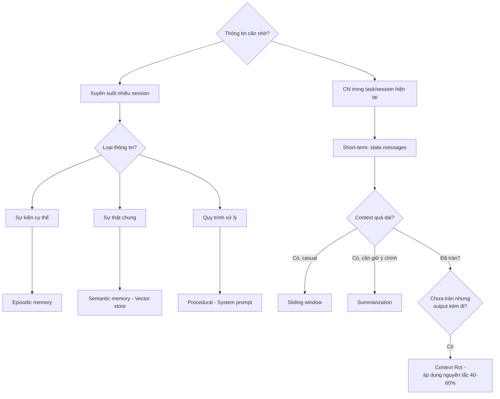
| Khái niệm | Ghi nhớ |
| --- | --- |
| Short-term | Context của session hiện tại, sống trong graph state |
| Long-term | Xuyên session, cần external store (DB/vector store) |
| Episodic | "Chuyện gì đã xảy ra" - gắn thời điểm |
| Semantic | "Sự thật là gì" - không gắn thời điểm |
| Procedural | "Cách làm task X" - system prompt / learned rules |
| Sliding window | Rẻ, mất thông tin hoàn toàn |
| Summarization | Vừa phải, nén nhưng giữ ý chính |
| Vector memory | Tốt cho long-term, cần retrieve đúng |
| Context compression | Áp dụng cho tool output, không chỉ hội thoại |
| Context Rot | Chất lượng giảm dù chưa tràn window - bắt đầu từ \~25-40% |
| Nguyên tắc 40-60% | Compact chủ động, đừng đợi đến khi gần đầy |
| Re-injection | Chèn lại chỉ dẫn quan trọng ở cuối context, chống fade-out |
# Bài 4: Agentic Tool Design & Integration
## Tổng quan
Chất lượng agent phụ thuộc rất nhiều vào chất lượng tool - tool thiết kế tồi khiến model gọi sai, gọi thừa, hoặc không biết khi nào dùng. Bài này bao gồm nguyên tắc thiết kế tool, chiến lược chọn tool khi có hàng trăm tool (bao gồm khủng hoảng tool sprawl và cách phòng thủ bằng progressive disclosure), bảo mật khi thực thi tool do LLM quyết định, và chuẩn MCP để chuẩn hoá tích hợp.
## 1. Tool Design Principles
### Atomic vs Composite
**Atomic tool** làm đúng 1 việc. **Composite tool** gộp nhiều bước thành 1 lời gọi.
```python
# Atomic - 3 tool riêng biệt
@tool
def get_customer(customer_id: str) -> dict:
    """Lấy thông tin khách hàng theo ID."""
    ...

@tool
def get_orders(customer_id: str) -> list:
    """Lấy danh sách đơn hàng của khách hàng."""
    ...

@tool
def get_payment_status(order_id: str) -> str:
    """Lấy trạng thái thanh toán của đơn hàng."""
    ...
```
```python
# Composite - gộp 3 bước trên thành 1 tool
@tool
def get_customer_full_summary(customer_id: str) -> dict:
    """Lấy thông tin khách hàng + đơn hàng + trạng thái thanh toán - tất cả trong 1 lần."""
    customer = get_customer(customer_id)
    orders = get_orders(customer_id)
    for order in orders:
        order["payment_status"] = get_payment_status(order["id"])
    return {"customer": customer, "orders": orders}
```
|  | Atomic | Composite |
| --- | --- | --- |
| Số lời gọi LLM | Nhiều hơn (model tự nối các bước) | Ít hơn (1 lời gọi = nhiều thao tác) |
| Linh hoạt | Cao - model tự quyết định thứ tự, có thể bỏ bước không cần | Thấp - luôn chạy full quy trình dù chỉ cần 1 phần |
| Độ trễ | Cao hơn (nhiều round-trip với LLM) | Thấp hơn (gộp trong 1 lần thực thi) |
| Dễ debug | Dễ hơn - mỗi tool 1 trách nhiệm rõ ràng | Khó hơn - lỗi có thể ở bất kỳ bước con nào |
**Nguyên tắc chọn**
Bắt đầu với atomic tools. Chỉ gộp thành composite khi đo được rằng model **luôn** gọi một chuỗi tool cố định theo cùng thứ tự - lúc đó composite giảm latency mà không mất linh hoạt thực tế.
### Error Handling
Tool phải trả về lỗi dưới dạng model **đọc hiểu được**, không phải raise exception làm crash agent.
```python
@tool
def get_weather(city: str) -> str:
    """Lấy thời tiết hiện tại của thành phố."""
    try:
        data = call_weather_api(city)
        return f"{city}: {data['temp']}°C, {data['condition']}"
    except CityNotFoundError:
        return f"Lỗi: Không tìm thấy thành phố '{city}'. Hãy kiểm tra lại tên hoặc thử tên tiếng Anh."
    except APITimeoutError:
        return "Lỗi: Dịch vụ thời tiết đang chậm phản hồi, hãy thử lại sau."
```
**Không để exception văng lên tận agent loop**
Nếu tool raise exception không bắt, toàn bộ graph crash thay vì cho model cơ hội thử cách khác. Luôn bọc logic tool trong try/except và trả về **message lỗi rõ ràng** để model tự quyết định bước tiếp theo (thử lại, hỏi user, dùng tool khác).
### Idempotency
Với tool có side effect (gửi email, tạo đơn hàng, xoá dữ liệu), cần đảm bảo gọi nhiều lần không gây hậu quả nhân đôi - vì model có thể gọi lại tool do retry hoặc do reasoning lặp.
```python
import hashlib

@tool
def create_order(customer_id: str, items: list, idempotency_key: str = None) -> dict:
    """Tạo đơn hàng mới. idempotency_key nên được set cố định cho cùng 1 yêu cầu logic."""
    key = idempotency_key or hashlib.sha256(
        f"{customer_id}-{items}".encode()
    ).hexdigest()

    existing = db.find_order_by_idempotency_key(key)
    if existing:
        return {"order_id": existing["id"], "status": "already_created"}

    order = db.create_order(customer_id, items, idempotency_key=key)
    return {"order_id": order["id"], "status": "created"}
```
**Áp dụng cho:** Mọi tool có side effect không thể hoàn tác dễ dàng - đặt hàng, gửi email/SMS, thanh toán, xoá dữ liệu.
## 2. Tool Selection
Khi agent có hàng chục đến hàng trăm tool, nhét toàn bộ schema vào mỗi lời gọi LLM vừa tốn token vừa khiến model dễ chọn nhầm tool.
### Khủng hoảng Tool Sprawl
Kết nối agent với nhiều MCP server (Bài 1, Bài 4 mục 4) rất dễ - và đó chính là vấn đề. Việc dễ kết nối khiến người ta kết nối quá nhiều tool mà không chọn lọc, và hệ quả đo được rất rõ:
| Chỉ số | Số liệu thực tế |
| --- | --- |
| Context bị tool chiếm (3 MCP server) | **143K/200K token (72%)** trước khi đọc tin nhắn user |
| GitHub MCP server mặc định | **91 tool definitions** |
| Độ chính xác chọn tool (bộ tool gọn) | \~43% |
| Độ chính xác chọn tool (bộ tool phình to) | Dưới 14% (giảm 3 lần) |
| Ngưỡng chính xác thực tế | **5-7 tool** cho độ chính xác ổn định |
**Nhiều tool hơn không có nghĩa là agent giỏi hơn**
Với \> 20 tool, model dễ nhầm giữa các tool tên/mô tả tương tự (`github_create_issue` vs `github_create_pull_request` vs `github_create_release`...) và bắt đầu **hallucinate tham số**. Đây là nguyên nhân phổ biến khiến agent "thông minh" hoạt động tệ hơn khi được cấp thêm quyền truy cập tool.
### Hierarchical Grouping
Chia tool thành nhóm theo domain, chỉ nạp nhóm liên quan dựa trên intent của user.
```python
TOOL_GROUPS = {
    "calendar": [check_calendar, create_event, cancel_event],
    "finance": [get_stock_price, get_exchange_rate, calculate_tax],
    "customer_support": [get_customer, get_orders, create_ticket],
}

def classify_intent(user_message: str) -> str:
    """Phân loại nhanh xem câu hỏi thuộc nhóm nào."""
    classify_prompt = f"""Câu hỏi sau thuộc nhóm nào: calendar, finance, customer_support?
Chỉ trả về 1 từ.

Câu hỏi: {user_message}"""
    return llm.invoke(classify_prompt).content.strip().lower()

def get_relevant_tools(user_message: str) -> list:
    group = classify_intent(user_message)
    return TOOL_GROUPS.get(group, [])
```
### Dynamic Loading & Tool Retrieval
Với số lượng tool rất lớn (hàng trăm, vd: mỗi API endpoint là 1 tool), dùng **embedding similarity** để retrieve tool liên quan nhất - giống RAG nhưng cho tool thay vì tài liệu.
```python
from langchain_openai import OpenAIEmbeddings
from langchain_community.vectorstores import Chroma

embedding = OpenAIEmbeddings(model="text-embedding-3-small")

# Index toàn bộ tool descriptions
tool_store = Chroma.from_texts(
    texts=[t.description for t in ALL_TOOLS],
    embedding=embedding,
    metadatas=[{"tool_name": t.name} for t in ALL_TOOLS],
)

def retrieve_relevant_tools(query: str, k: int = 5) -> list:
    """Chỉ lấy top-k tool liên quan nhất thay vì nạp toàn bộ."""
    results = tool_store.similarity_search(query, k=k)
    tool_names = {r.metadata["tool_name"] for r in results}
    return [t for t in ALL_TOOLS if t.name in tool_names]

def agent_node(state: AgentState) -> dict:
    user_query = state["messages"][-1].content
    relevant_tools = retrieve_relevant_tools(user_query)
    llm_with_tools = llm.bind_tools(relevant_tools)
    response = llm_with_tools.invoke(state["messages"])
    return {"messages": [response]}
```
| Chiến lược | Phù hợp khi | Đánh đổi |
| --- | --- | --- |
| Nạp toàn bộ tool | \< 10-15 tool | Đơn giản, nhưng không scale |
| Hierarchical grouping | Tool có domain rõ ràng, số nhóm cố định | Cần bước classify trước, có thể phân loại sai |
| Tool retrieval (embedding) | Hàng trăm tool, domain đa dạng | Thêm độ trễ + chi phí embedding, có thể miss tool đúng nếu description mơ hồ |
**Chất lượng description quyết định retrieval**
Tool retrieval chỉ tốt bằng chất lượng `description` của tool. Viết description theo văn phong người dùng sẽ hỏi ("tìm nhà hàng theo khu vực"), không theo văn phong kỹ thuật ("query restaurant table by location_id").
### Tool Search: Meta-tool thay vì nạp toàn bộ
Thay vì nạp tất cả schema vào mỗi request, cấp cho agent **một tool duy nhất** để tự tìm tool khi cần - cách tiếp cận mà Anthropic dùng trong Claude Code.
```python
@tool
def tool_search(query: str, max_results: int = 5) -> list[dict]:
    """Tìm kiếm tool khả dụng theo mô tả. Dùng tool này trước khi
    gọi bất kỳ tool nào bạn chưa từng dùng trong hội thoại này.

    Ví dụ: tool_search("tạo pull request")
    -> Trả về định nghĩa đầy đủ của tool github_create_pull_request
    """
    matches = search_tool_index(query)
    return matches[:max_results]  # Định nghĩa được inject động vào context
```
Agent bắt đầu chỉ với `tool_search`, tự tìm và "khám phá" tool phù hợp, rồi mới gọi. Dữ liệu của Anthropic: giảm **85% token** so với nạp toàn bộ. Đánh đổi là thêm 1 vòng round-trip LLM - nhưng vì mỗi lời gọi có context nhỏ hơn nhiều, tổng thời gian thường vẫn **nhanh hơn** do model xử lý input ngắn nhanh hơn đáng kể.
### Progressive Disclosure 3 tầng (cho Skills)
Khi agent có nhiều **skill** (quy trình nhiều bước, không chỉ 1 tool đơn lẻ - xem MCP ở mục 4), áp dụng nguyên tắc: nạp **metadata trước, hướng dẫn chi tiết sau, tài nguyên phụ trợ cuối cùng**.
| Tầng | Nội dung | Khi nào nạp | Kích thước |
| --- | --- | --- | --- |
| **Tầng 1 - Discovery** | Tên + mô tả ngắn của mọi skill | Luôn có trong context | \~100 token/skill |
| **Tầng 2 - Activation** | Hướng dẫn đầy đủ (các bước, error handling) | Khi agent quyết định dùng skill đó | \~500-2000 token |
| **Tầng 3 - Execution** | File tham chiếu, script hỗ trợ | Khi một bước cụ thể cần đến | Theo nhu cầu |
```python
# Tầng 1: catalog nhẹ, luôn trong context (~100 token/skill)
SKILL_CATALOG = """
| Skill | Mô tả |
|-------|-------|
| tao-github-pr | Tạo và quản lý pull request trên GitHub |
| deploy-production | Deploy ứng dụng lên production với rollback |
"""

@tool
def load_skill(skill_name: str) -> str:
    """Nạp hướng dẫn đầy đủ cho 1 skill cụ thể (Tầng 2)."""
    return read_file(f"skills/{skill_name}/SKILL.md")
```
Với 100 skill, cách này giảm từ \~300.000 token (nạp hết) xuống còn \~19.000 token (nạp theo tầng) - tiết kiệm \~94%.
### Nguyên tắc 5-Tool
Cách đơn giản và hiệu quả nhất: **giới hạn cứng mỗi agent tối đa 5 tool**, thiết kế mỗi agent như một chuyên gia hẹp thay vì một agent "biết tuốt".
```python
# Mỗi agent là chuyên gia với tối đa 5 tool
agents = {
    "explorer": Agent(tools=[grep, glob, read_file, list_dir, web_search]),
    "coder": Agent(tools=[read_file, edit_file, write_file, run_command, run_tests]),
    "deployer": Agent(tools=[git_push, create_pr, deploy, check_status, rollback]),
}
# Route đến đúng chuyên gia thay vì 1 agent ôm hết tool
```
Nguyên tắc này liên hệ trực tiếp với Multi-Agent Systems (Bài 6): chia nhỏ trách nhiệm thành nhiều agent chuyên biệt vừa giải quyết vấn đề tool sprawl, vừa là lý do kiến trúc chính đáng để dùng multi-agent.
## 3. Tool Security
Tool cho phép LLM **hành động** trong thế giới thực - đây là bề mặt tấn công lớn nhất của agent (prompt injection từ tài liệu/web có thể khiến model gọi tool ngoài ý muốn user).
### Sandboxing
Tool thực thi code hoặc truy cập filesystem/network phải chạy trong môi trường cô lập.
```python
import subprocess

@tool
def run_python_code(code: str) -> str:
    """Chạy code Python trong sandbox, trả về output. Không có quyền truy cập network/filesystem ngoài thư mục tạm."""
    try:
        result = subprocess.run(
            ["docker", "run", "--rm", "--network=none",
             "--memory=256m", "--cpus=0.5",
             "python-sandbox:latest", "python", "-c", code],
            capture_output=True, text=True, timeout=10,
        )
        return result.stdout or result.stderr
    except subprocess.TimeoutExpired:
        return "Lỗi: Code chạy quá 10 giây, đã bị dừng."
```
**Không bao giờ chạy code do LLM sinh ra trực tiếp trên host**
`exec()` hay `subprocess` trực tiếp trên máy chủ ứng dụng là lỗ hổng nghiêm trọng - prompt injection có thể khiến model sinh code độc hại. Luôn dùng container cô lập (`--network=none`, giới hạn memory/CPU, không mount volume nhạy cảm).
### Rate Limiting
Giới hạn số lần agent được gọi tool (đặc biệt tool tốn phí hoặc có side effect) trong 1 khoảng thời gian/session.
```python
from collections import defaultdict
import time

class ToolRateLimiter:
    def __init__(self, max_calls: int, window_seconds: int):
        self.max_calls = max_calls
        self.window = window_seconds
        self.calls = defaultdict(list)

    def check(self, tool_name: str, session_id: str) -> bool:
        key = f"{session_id}:{tool_name}"
        now = time.time()
        self.calls[key] = [t for t in self.calls[key] if now - t < self.window]
        if len(self.calls[key]) >= self.max_calls:
            return False
        self.calls[key].append(now)
        return True

limiter = ToolRateLimiter(max_calls=5, window_seconds=60)

def guarded_tool_execution(tool_name: str, session_id: str, **kwargs):
    if not limiter.check(tool_name, session_id):
        return f"Lỗi: Vượt giới hạn gọi '{tool_name}' (tối đa 5 lần/phút)."
    return execute_tool(tool_name, **kwargs)
```
### Audit Logs
Ghi lại **mọi** tool call (ai, tool gì, tham số gì, kết quả gì, khi nào) - bắt buộc cho tool có side effect, hữu ích để debug và điều tra sự cố.
```python
import logging
import json
from datetime import datetime

audit_logger = logging.getLogger("agent_audit")

def log_tool_call(session_id: str, tool_name: str, args: dict, result: str, user_id: str):
    audit_logger.info(json.dumps({
        "timestamp": datetime.utcnow().isoformat(),
        "session_id": session_id,
        "user_id": user_id,
        "tool": tool_name,
        "args": args,
        "result_preview": result[:200],
    }))
```
**Audit log khác observability (Bài 5)**
Audit log tập trung vào **trách nhiệm giải trình** (ai làm gì, khi nào, để điều tra sau) - thường là log bất biến, giữ lâu dài vì lý do compliance. Observability (Bài 5) tập trung vào **hiệu năng và chất lượng** (latency, cost, trajectory) - để cải thiện hệ thống. Hai mục đích khác nhau dù dữ liệu có thể overlap.
## 4. MCP: Standards, Server, Clients
MCP (Model Context Protocol) chuẩn hoá cách agent giao tiếp với tool/data source, đã giới thiệu khái niệm ở Bài 1. Phần này đi vào cách implement.
### Kiến trúc
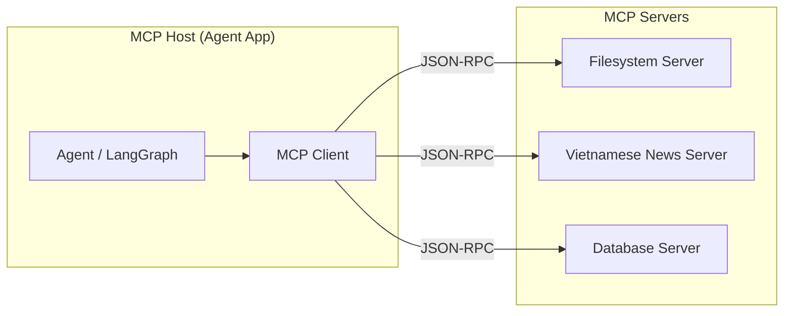
MCP giao tiếp qua **JSON-RPC**, mỗi Server expose 3 loại primitive:
| Primitive | Vai trò | Tương đương |
| --- | --- | --- |
| **Tools** | Hành động Server cho phép Client gọi | Function calling |
| **Resources** | Dữ liệu Server expose để đọc | Tài liệu / file |
| **Prompts** | Template prompt tái sử dụng được Server cung cấp | Prompt library |
### Viết một MCP Server tối giản
```python
from mcp.server.fastmcp import FastMCP

mcp = FastMCP("vietnamese-news")

@mcp.tool()
def search_news(query: str, limit: int = 5) -> list[dict]:
    """Tìm kiếm tin tức tiếng Việt mới nhất theo từ khoá."""
    results = call_news_api(query, limit=limit)
    return [{"title": r["title"], "url": r["url"], "published": r["date"]} for r in results]

@mcp.resource("news://categories")
def list_categories() -> str:
    """Danh sách chuyên mục tin tức có sẵn."""
    return "Thời sự, Kinh doanh, Thể thao, Công nghệ, Giải trí"

if __name__ == "__main__":
    mcp.run(transport="stdio")
```
### Kết nối Client (từ LangGraph agent)
```python
from langchain_mcp_adapters.client import MultiServerMCPClient

mcp_client = MultiServerMCPClient({
    "vietnamese_news": {
        "command": "python",
        "args": ["vietnamese_news_server.py"],
        "transport": "stdio",
    },
})

# Tool từ MCP Server dùng được y hệt tool định nghĩa bằng @tool
mcp_tools = await mcp_client.get_tools()
llm_with_tools = llm.bind_tools(mcp_tools)
```
**MCP giá trị nhất khi tool được tái sử dụng ở nhiều agent/app**
Nếu chỉ có 1 agent dùng 1 tool nội bộ, viết `@tool` trực tiếp (như Bài 2) đơn giản hơn. MCP đáng giá khi cùng 1 tool/data source cần phục vụ nhiều agent khác nhau (vd: news scraper dùng cho cả research agent lẫn chatbot khác) - viết 1 Server, mọi Client đều dùng lại được.
## Tóm tắt
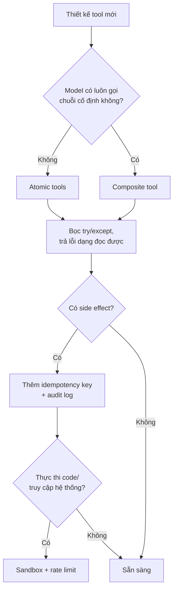
| Nguyên tắc | Ghi nhớ |
| --- | --- |
| Atomic vs Composite | Bắt đầu atomic, gộp composite khi đo được pattern cố định |
| Error handling | Trả lỗi dạng text model đọc được, không raise exception |
| Idempotency | Bắt buộc cho tool có side effect không hoàn tác được |
| Hierarchical grouping | Nhóm tool theo domain, classify intent trước khi nạp |
| Tool retrieval | Embedding similarity khi có hàng trăm tool |
| Tool sprawl | \> 20 tool: độ chính xác chọn tool giảm mạnh, dễ hallucinate tham số |
| Tool search | Meta-tool duy nhất để agent tự khám phá tool khi cần, giảm \~85% token |
| Progressive disclosure | Nạp metadata trước, hướng dẫn chi tiết sau, tài nguyên cuối cùng |
| Nguyên tắc 5-Tool | Giới hạn cứng mỗi agent tối đa 5 tool - chuyên gia hẹp thay vì biết tuốt |
| Sandboxing | Không bao giờ exec code LLM sinh ra trực tiếp trên host |
| Rate limiting | Giới hạn theo session + tool, đặc biệt tool tốn phí |
| Audit logs | Bắt buộc cho side-effect tools, phục vụ compliance |
| MCP | Chuẩn hoá khi 1 tool cần phục vụ nhiều agent/app |
# Bài 5: Agent Evaluation & Observability
## Tổng quan
RAGAS và LLM-as-judge (Module I, Bài 7) đánh giá output cuối cùng - đủ cho RAG nhưng không đủ cho agent, vì agent có thể ra đúng đáp án bằng con đường sai (hoặc tốn kém, hoặc nguy hiểm). Bài này mở rộng evaluation sang **trajectory** - toàn bộ chuỗi hành động agent thực hiện - và cách giám sát agent trong production.
## 1. Eval Dimensions
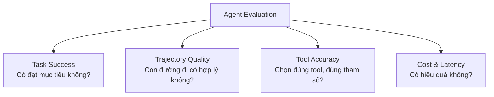
| Chiều đánh giá | Câu hỏi | Ví dụ vấn đề nếu bỏ qua |
| --- | --- | --- |
| **Task Success** | Agent có hoàn thành mục tiêu người dùng đề ra không? | Đây là metric "must-have" nhưng không đủ - có thể đúng do may mắn |
| **Trajectory Quality** | Chuỗi bước có logic, không lặp vô ích, không đi đường vòng? | Agent trả lời đúng nhưng gọi tool 15 lần cho task cần 3 lần |
| **Tool Accuracy** | Có chọn đúng tool? Tham số truyền vào có chính xác? | Agent gọi `get_weather(city="Hà Lội")`  • lỗi chính tả khiến tool fail |
| **Cost & Latency** | Tổng token, tổng thời gian, tổng số lời gọi LLM/tool? | 2 agent cùng ra đúng đáp án nhưng 1 agent tốn gấp 5 lần chi phí |
Task Success cao không có nghĩa là agent tốt. Một agent có thể đạt task success 95% nhưng trajectory kém - gọi tool thừa, lãng phí chi phí, hoặc thực hiện hành động rủi ro (xoá nhầm dữ liệu rồi tạo lại) mà vẫn ra kết quả đúng cuối cùng. Production cần đánh giá cả 4 chiều, không chỉ chiều cuối.
## 2. Methodologies
### End-to-end Evaluation
So sánh output cuối với expected outcome - tương tự LLM-as-judge ở Module I nhưng áp dụng cho toàn bộ agent run.
```python
from openai import OpenAI
import json

client = OpenAI()

def evaluate_task_success(task: str, final_output: str, success_criteria: str) -> dict:
    judge_prompt = f"""Đánh giá agent có hoàn thành nhiệm vụ không.

Nhiệm vụ: {task}
Tiêu chí thành công: {success_criteria}
Kết quả agent trả về: {final_output}

Trả về JSON: {{"success": true/false, "score": 0-1, "reasoning": "..."}}"""

    response = client.chat.completions.create(
        model="gpt-4o-mini",
        messages=[{"role": "user", "content": judge_prompt}],
        response_format={"type": "json_object"},
    )
    return json.loads(response.choices[0].message.content)
```
### Trajectory Evaluation
Đánh giá **toàn bộ chuỗi** Thought/Action/Observation, không chỉ câu trả lời cuối - phát hiện các vấn đề mà end-to-end eval bỏ sót.
```python
def evaluate_trajectory(task: str, trajectory: list[dict]) -> dict:
    """
    trajectory: [{"action": "search_news", "args": {...}, "observation": "..."}, ...]
    """
    formatted = "\n".join([
        f"Bước {i+1}: gọi {step['action']}({step['args']}) → {step['observation'][:150]}"
        for i, step in enumerate(trajectory)
    ])

    judge_prompt = f"""Đánh giá chuỗi hành động của agent cho nhiệm vụ sau.

Nhiệm vụ: {task}

Chuỗi hành động:
{formatted}

Đánh giá theo tiêu chí (1-5):
1. Efficiency: Có bước thừa/lặp không cần thiết không?
2. Logical order: Thứ tự bước có hợp lý không?
3. Tool correctness: Tool và tham số có phù hợp với mục đích từng bước không?
4. Recovery: Nếu có bước lỗi, agent có xử lý hợp lý không?

Trả về JSON: {{"efficiency": X, "logical_order": X, "tool_correctness": X, "recovery": X, "issues": ["..."]}}"""

    response = client.chat.completions.create(
        model="gpt-4o-mini",
        messages=[{"role": "user", "content": judge_prompt}],
        response_format={"type": "json_object"},
    )
    return json.loads(response.choices[0].message.content)
```
### LLM-as-Judge cho Agent
Áp dụng lại các nguyên tắc giảm bias từ Module I (Bài 7) - đặc biệt quan trọng hơn với agent vì trajectory dài, dễ bị **verbosity bias** (judge thiên vị trajectory dài, chi tiết hơn dù không hiệu quả hơn).
**Tái sử dụng nguyên tắc giảm bias từ Module I**
6 loại bias của LLM-as-judge (position, verbosity, self-preference, style, calibration drift, preference leakage) đã học ở [Module I, Bài 7](https://handbook.yourclassacademy.com/llm-engineer/module-1/07-evaluation-guardrails/#llm-as-judge) áp dụng nguyên vẹn cho agent evaluation. Với trajectory dài, verbosity bias càng dễ xảy ra - judge có thể đánh giá cao trajectory "trông kỹ lưỡng" dù thực chất kém hiệu quả hơn.
### Unit Tests cho Tool Calls
Kiểm tra xác định (deterministic) - không cần LLM judge - cho các trường hợp có đáp án rõ ràng.
```python
import pytest

def test_agent_calls_correct_tool_for_weather_query():
    result = run_agent("Thời tiết Hà Nội hôm nay thế nào?")
    tool_calls = extract_tool_calls(result)

    assert len(tool_calls) == 1
    assert tool_calls[0]["name"] == "get_weather"
    assert tool_calls[0]["args"]["city"] in ["Hà Nội", "Hanoi"]

def test_agent_does_not_call_tool_for_greeting():
    """Agent không nên gọi tool cho câu chào đơn giản - kiểm tra tránh over-calling."""
    result = run_agent("Xin chào!")
    tool_calls = extract_tool_calls(result)
    assert len(tool_calls) == 0

def test_agent_respects_max_retry_on_tool_error():
    result = run_agent_with_mocked_failing_tool(max_retries=3)
    assert result["retry_count"] <= 3
```
**Phù hợp khi:** Test case có đáp án đúng/sai rõ ràng (tool nào nên/không nên được gọi, giới hạn retry có được tôn trọng không) - nhanh, rẻ, chạy được trong CI.
### So sánh methodologies
| Phương pháp | Chi phí | Tốc độ | Phát hiện được |
| --- | --- | --- | --- |
| Unit tests | Thấp | Nhanh (không cần LLM) | Lỗi rõ ràng, có thể assert được |
| End-to-end (LLM judge) | Trung bình | Trung bình | Task có hoàn thành không |
| Trajectory eval | Cao (chuỗi dài) | Chậm | Hiệu quả, đường đi hợp lý, tool đúng |
## 3. Observability
Evaluation chạy **offline** (trước khi deploy, trên test set). Observability giám sát agent **online** (production, real-time).
### Tracing với LangSmith
```python
import os

os.environ["LANGCHAIN_TRACING_V2"] = "true"
os.environ["LANGCHAIN_API_KEY"] = "ls__..."
os.environ["LANGCHAIN_PROJECT"] = "vietnamese-research-agent"

# Mọi lời gọi LangGraph agent tự động được trace - mỗi node, mỗi tool call,
# mỗi token usage đều xuất hiện trên dashboard LangSmith
result = app.invoke({"messages": [...]}, config=config)
```
Trace của agent hiển thị dạng cây, phản ánh đúng graph: node nào gọi node nào, tool nào được gọi với tham số gì, mất bao lâu, tốn bao nhiêu token - khác với trace của 1 lời gọi LLM đơn (Module I) vốn chỉ là 1 span phẳng.
### LangFuse (self-hosted alternative)
```python
from langfuse.callback import CallbackHandler

langfuse_handler = CallbackHandler(
    public_key="pk-lf-...",
    secret_key="sk-lf-...",
    host="https://cloud.langfuse.com",
)

result = app.invoke(
    {"messages": [...]},
    config={"callbacks": [langfuse_handler], **config},
)
```
### OpenTelemetry cho hệ thống đa framework
Khi agent kết hợp nhiều framework/service (vd: LangGraph + custom microservice), OpenTelemetry cung cấp chuẩn tracing không gắn với 1 vendor cụ thể.
```python
from opentelemetry import trace
from opentelemetry.sdk.trace import TracerProvider
from opentelemetry.sdk.trace.export import BatchSpanProcessor
from opentelemetry.exporter.otlp.proto.grpc.trace_exporter import OTLPSpanExporter

trace.set_tracer_provider(TracerProvider())
trace.get_tracer_provider().add_span_processor(
    BatchSpanProcessor(OTLPSpanExporter(endpoint="http://localhost:4317"))
)
tracer = trace.get_tracer("agent-service")

def agent_node(state: AgentState) -> dict:
    with tracer.start_as_current_span("agent_node") as span:
        response = llm.invoke(state["messages"])
        span.set_attribute("token_usage", response.usage_metadata["total_tokens"])
        return {"messages": [response]}
```
| Công cụ | Điểm mạnh | Dùng khi |
| --- | --- | --- |
| **LangSmith** | Tích hợp sâu với LangGraph/LangChain, dashboard sẵn cho agent trace | Stack chính là LangChain/LangGraph |
| **LangFuse** | Open-source, tự host được, không vendor lock-in | Cần kiểm soát dữ liệu, ngân sách hạn chế |
| **OpenTelemetry** | Chuẩn mở, tích hợp được với hệ thống ngoài LLM (backend, DB) | Kiến trúc đa framework, cần trace xuyên suốt toàn hệ thống |
### Metrics cần giám sát cho Agent (mở rộng từ Module I)
| Metric | Mô tả | Alert threshold |
| --- | --- | --- |
| Task success rate | % task hoàn thành đúng | \< 90% |
| Avg steps per task | Số bước trung bình để hoàn thành | Tăng đột biến so với baseline |
| Tool error rate | % tool call thất bại | \> 5% |
| Cost per task | Tổng token × giá, trung bình mỗi task | Vượt budget |
| Human intervention rate | % task cần HITL can thiệp | Tăng bất thường (dấu hiệu agent kém tự tin) |
| Loop detection | Số lần agent lặp lại cùng 1 tool call | \> 3 lần liên tiếp |
## Tóm tắt
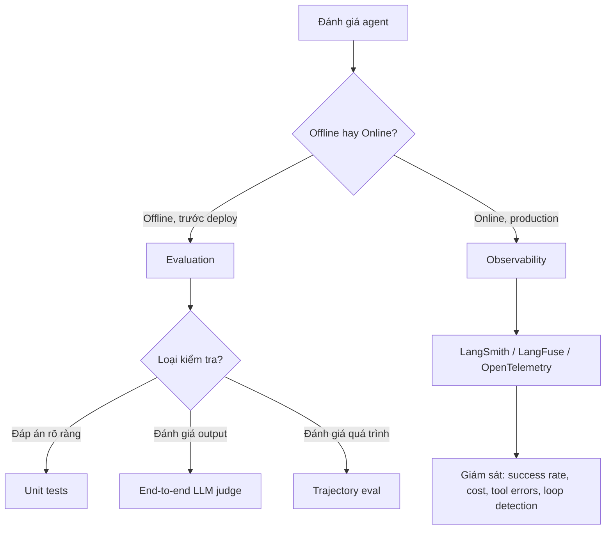
| Khái niệm | Ghi nhớ |
| --- | --- |
| Task Success | Cần nhưng không đủ - đúng đáp án không đồng nghĩa quá trình tốt |
| Trajectory Quality | Đánh giá cả con đường đi, không chỉ đích đến |
| Tool Accuracy | Chọn đúng tool + đúng tham số |
| Cost & Latency | So sánh hiệu quả giữa các agent cùng đạt task success |
| Unit tests | Nhanh, rẻ, cho case có đáp án xác định - chạy trong CI |
| Trajectory eval | Cần LLM judge, phát hiện lãng phí/đi đường vòng |
| LangSmith/LangFuse | Trace cây phản ánh cấu trúc graph, khác trace phẳng của Module I |
| Loop detection | Metric đặc thù agent - phát hiện agent kẹt lặp vô ích |
# Bài 6: Multi-Agent Systems
## Tổng quan
Một agent với quá nhiều tool và trách nhiệm trở nên khó kiểm soát - system prompt phình to, model dễ nhầm lẫn giữa các domain. Bài này trình bày các pattern chia nhỏ công việc cho nhiều agent chuyên biệt, so sánh framework hỗ trợ multi-agent, và thực hành xây dựng hệ thống multi-agent với LangGraph - nền tảng trực tiếp cho capstone.
## 1. Patterns
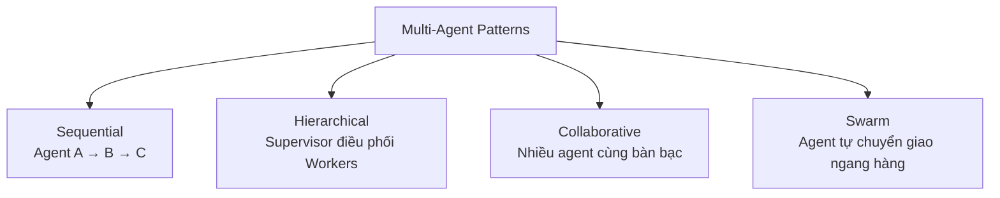
### Sequential
Agent chạy theo thứ tự cố định, output của agent trước là input của agent sau.
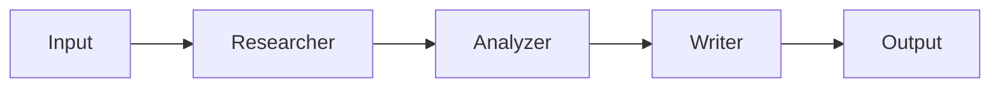
**Phù hợp khi:** Quy trình có thứ tự rõ ràng, không cần agent quay lại bước trước (vd: research → phân tích → viết báo cáo).
### Hierarchical (Supervisor)
Một **Supervisor agent** nhận task, quyết định giao cho Worker agent nào, tổng hợp kết quả - Worker không giao tiếp trực tiếp với nhau.
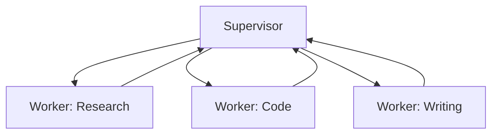
**Phù hợp khi:** Task cần định tuyến động (không biết trước cần Worker nào), cần kiểm soát tập trung về thứ tự và điều phối.
### Collaborative
Nhiều agent cùng thảo luận, phản biện lẫn nhau trước khi chốt kết quả - không có thứ bậc cố định.
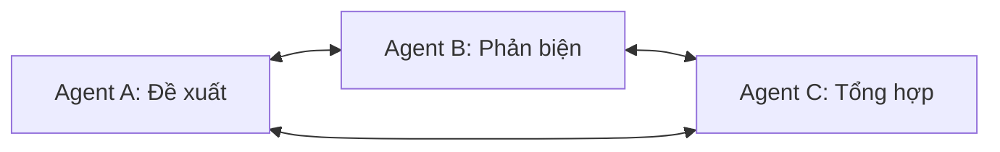
**Phù hợp khi:** Task cần nhiều góc nhìn để giảm sai sót (vd: 1 agent viết code, 1 agent review, lặp lại đến khi đạt chất lượng).
### Swarm
Agent tự quyết định chuyển giao (handoff) trực tiếp cho agent khác dựa trên ngữ cảnh, không qua Supervisor trung tâm.
```mermaid
graph LR
    A1[Agent Sales] -->|handoff khi cần kỹ thuật| A2[Agent Support]
    A2 -->|handoff khi cần thanh toán| A3[Agent Billing]
    A3 -->|handoff khi user muốn mua thêm| A1
```
**Phù hợp khi:** Ngữ cảnh hội thoại chuyển hướng linh hoạt, không có "trung tâm điều phối" tự nhiên (vd: hệ thống customer service đa domain).
### So sánh 4 pattern
| Pattern | Kiểm soát | Độ phức tạp giao tiếp | Phù hợp |
| --- | --- | --- | --- |
| Sequential | Cao (thứ tự cố định) | Thấp | Quy trình tuyến tính, biết trước các bước |
| Hierarchical | Cao (qua Supervisor) | Trung bình | Cần định tuyến động, nhiều domain worker |
| Collaborative | Trung bình | Cao (nhiều vòng qua lại) | Cần chất lượng cao qua phản biện |
| Swarm | Thấp (phi tập trung) | Cao (handoff động) | Hội thoại chuyển domain linh hoạt |
Capstone dùng Hierarchical
Kiến trúc Planner → Researcher/Analyzer/Writer trong capstone (Bài 7) là pattern **Hierarchical**: Planner đóng vai Supervisor, điều phối 3 Worker chuyên biệt theo kế hoạch đã lập.
## 2. Framework Comparison
| Framework | Cách biểu diễn multi-agent | Điểm mạnh | Điểm yếu |
| --- | --- | --- | --- |
| **LangGraph** | Mỗi agent là 1 subgraph/node, giao tiếp qua shared state | Kiểm soát chi tiết luồng dữ liệu, dễ debug, tích hợp checkpointer/HITL đã học | Cần tự code cấu trúc điều phối |
| **CrewAI** | Định nghĩa "Crew" gồm nhiều "Agent" có role/goal, "Task" được gán cho agent | API cấp cao, khai báo nhanh (role, goal, backstory) | Ít linh hoạt khi cần logic điều phối phức tạp/rẽ nhánh |
| **OpenAI Agents SDK** | "Handoffs" giữa các Agent, mỗi Agent có instructions + tools riêng | Đơn giản cho pattern Swarm, tích hợp chặt OpenAI models | Gắn với hệ sinh thái OpenAI, ít kiểm soát state chi tiết |
| **AutoGen** | Agent giao tiếp qua conversation (message passing), có GroupChat | Mạnh cho Collaborative pattern, nhiều agent "thảo luận" | Khó kiểm soát chính xác luồng như graph tường minh |
```python
# So sánh cú pháp: cùng 1 ý tưởng (Supervisor điều phối Researcher + Writer)

# --- CrewAI ---
researcher = Agent(role="Researcher", goal="Tìm thông tin chính xác")
writer = Agent(role="Writer", goal="Viết báo cáo dễ hiểu")
crew = Crew(agents=[researcher, writer], tasks=[research_task, write_task], process=Process.sequential)

# --- OpenAI Agents SDK ---
researcher = Agent(name="Researcher", instructions="Tìm thông tin", handoffs=[])
writer = Agent(name="Writer", instructions="Viết báo cáo", handoffs=[])
triage = Agent(name="Supervisor", handoffs=[researcher, writer])
```
Vì sao capstone vẫn dùng LangGraph cho multi-agent
LangGraph biểu diễn multi-agent như **subgraph lồng trong graph lớn hơn** - state, checkpointer, HITL, và tool execution loop đã học ở Bài 2-4 dùng lại được nguyên vẹn cho từng agent con. Điều này tránh phải học lại 1 mental model mới hoàn toàn như khi chuyển sang CrewAI/AutoGen.
## 3. Hands-on: Multi-agent với LangGraph
Ví dụ Supervisor điều phối 2 Worker: Researcher (tìm thông tin) và Writer (viết tóm tắt) - đơn giản hoá của kiến trúc capstone.
```python
from typing import TypedDict, Annotated
from langgraph.graph import StateGraph, START, END
from langgraph.graph.message import add_messages
from langchain_openai import ChatOpenAI
from langchain_core.tools import tool

llm = ChatOpenAI(model="gpt-4o-mini", temperature=0.2)

# ====== SHARED STATE ======
class SupervisorState(TypedDict):
    messages: Annotated[list, add_messages]
    task: str
    research_notes: str
    next_agent: str

# ====== TOOLS cho Researcher ======
@tool
def search_web(query: str) -> str:
    """Tìm kiếm thông tin trên web."""
    return f"Kết quả tìm kiếm cho '{query}': [thông tin mô phỏng]"

# ====== SUPERVISOR NODE ======
SUPERVISOR_PROMPT = """Bạn điều phối 2 agent: 'researcher' (tìm thông tin) và 'writer' (viết báo cáo từ thông tin đã có).
Nhiệm vụ: {task}
Ghi chú nghiên cứu hiện có: {notes}

Quyết định agent tiếp theo cần chạy. Nếu đã đủ thông tin để viết, chọn 'writer'.
Nếu đã có báo cáo hoàn chỉnh, chọn 'done'.
Chỉ trả về 1 từ: researcher, writer, hoặc done."""

def supervisor_node(state: SupervisorState) -> dict:
    decision = llm.invoke(SUPERVISOR_PROMPT.format(
        task=state["task"], notes=state.get("research_notes", "Chưa có")
    )).content.strip().lower()
    return {"next_agent": decision}

def route_supervisor(state: SupervisorState) -> str:
    return state["next_agent"] if state["next_agent"] in ["researcher", "writer"] else END

# ====== RESEARCHER SUBGRAPH ======
def researcher_node(state: SupervisorState) -> dict:
    llm_with_tools = llm.bind_tools([search_web])
    response = llm_with_tools.invoke(
        f"Nghiên cứu thông tin cho nhiệm vụ: {state['task']}"
    )
    if response.tool_calls:
        results = [search_web.invoke(c["args"]) for c in response.tool_calls]
        notes = "\n".join(results)
    else:
        notes = response.content
    return {"research_notes": state.get("research_notes", "") + "\n" + notes}

# ====== WRITER NODE ======
def writer_node(state: SupervisorState) -> dict:
    report = llm.invoke(
        f"Viết báo cáo ngắn gọn cho nhiệm vụ '{state['task']}' dựa trên:\n{state['research_notes']}"
    )
    return {"messages": [report]}

# ====== BUILD GRAPH ======
graph = StateGraph(SupervisorState)
graph.add_node("supervisor", supervisor_node)
graph.add_node("researcher", researcher_node)
graph.add_node("writer", writer_node)

graph.add_edge(START, "supervisor")
graph.add_conditional_edges(
    "supervisor", route_supervisor,
    {"researcher": "researcher", "writer": "writer", END: END},
)
graph.add_edge("researcher", "supervisor")  # Quay lại Supervisor sau khi research xong
graph.add_edge("writer", "supervisor")      # Quay lại Supervisor để xác nhận done

app = graph.compile()

# ====== CHẠY ======
# Luôn set recursion_limit - vòng Supervisor -> Worker -> Supervisor
# có thể chạy vô hạn nếu Supervisor không bao giờ quyết định "done"
result = app.invoke(
    {
        "messages": [],
        "task": "Tóm tắt xu hướng AI Agent tại Việt Nam năm 2026",
        "research_notes": "",
        "next_agent": "",
    },
    config={"recursion_limit": 10},
)
print(result["messages"][-1].content)
```
Giới hạn số vòng Supervisor ↔ Worker
Giống ReAct loop (Bài 1-2), vòng lặp Supervisor → Worker → Supervisor có thể chạy vô hạn nếu Supervisor không bao giờ quyết định `done`. Luôn set `recursion_limit` và cân nhắc thêm đếm số vòng tối đa trong state.
## Tóm tắt
```mermaid
graph TD
    Q{Cấu trúc task?} --> A[Thứ tự cố định, biết trước các bước]
    Q --> B[Cần định tuyến động giữa các domain worker]
    Q --> C[Cần nhiều góc nhìn phản biện lẫn nhau]
    Q --> D[Hội thoại chuyển domain linh hoạt, phi tập trung]
    A --> SEQ[Sequential]
    B --> HIER[Hierarchical - Supervisor]
    C --> COLLAB[Collaborative]
    D --> SWARM[Swarm]

    HIER --> FW{Framework?}
    FW --> LG[LangGraph - tái dùng state/HITL đã học]
    FW --> CREW[CrewAI - khai báo nhanh role/goal]
    FW --> OAI[OpenAI Agents SDK - handoffs đơn giản]
```
| Pattern | Ghi nhớ |
| --- | --- |
| Sequential | A → B → C cố định, không quay lại |
| Hierarchical | Supervisor điều phối, Worker không giao tiếp trực tiếp |
| Collaborative | Nhiều agent phản biện qua lại để tăng chất lượng |
| Swarm | Handoff ngang hàng, phi tập trung |
| LangGraph multi-agent | Subgraph + shared state, tái dùng checkpointer/HITL |
| CrewAI | Nhanh cho prototype, khai báo role/goal cấp cao |
| Giới hạn vòng lặp | Bắt buộc với mọi Supervisor loop, tránh chạy vô hạn |
# Bài 7: Capstone Project - Multi-Agent Vietnamese Research Assistant
## Tổng quan
Capstone tích hợp toàn bộ Module II thành một hệ thống multi-agent hoàn chỉnh: Planner + Researcher + Analyzer + Writer phối hợp theo pattern Hierarchical (Bài 6) với LangGraph, tái sử dụng RAG pipeline / vector store từ Module I - Capstone làm retrieval tool cho Researcher.
Nội dung đang được biên soạn
Bài này sẽ bao gồm: kiến trúc chi tiết 4 agent, phần take-home (retry logic, parallelism, human-in-the-loop, custom MCP server cho Vietnamese news scraper), và quy trình đánh giá bằng LLM-as-judge trên trajectory.
## Kiến trúc dự kiến
```mermaid
graph TD
    subgraph Hierarchical Multi-Agent
        PLAN[Planner] --> RES[Researcher]
        PLAN --> ANA[Analyzer]
        PLAN --> WRI[Writer]
        RES --> PLAN
        ANA --> PLAN
        WRI --> PLAN
    end

    RES --> RAG[(Vector Store<br/>từ Module I Capstone)]
    RES --> MCP[Custom MCP Server<br/>Vietnamese News Scraper]
```
## Phụ thuộc
- **RAG pipeline & Vector DB** (Module I, Bài 9) - tái sử dụng làm retrieval tool cho Researcher agent.
- **LangGraph multi-agent** (Bài 6) - nền tảng cho kiến trúc Supervisor (Planner) + Workers.
- **MCP** (Bài 4) - chuẩn để viết custom Vietnamese news scraper server.
- **Agent Evaluation** (Bài 5) - LLM-as-judge cho trajectory evaluation.
# Bài 8: Workshop + Mock Interview
## Tổng quan
Buổi tổng kết Module II: showcase capstone của học viên, phỏng vấn thử, và góc nhìn thực tế về thị trường AI Agent tại Việt Nam.
Nội dung đang được biên soạn
Bài này sẽ bao gồm: format Capstone Showcase (4 demo được chọn trước × 10 phút gồm demo + walkthrough + Q&A) và phần Guest Speaker về AI Agent Landscape in Vietnam 2026.
## Cấu trúc dự kiến
| Phần | Nội dung |
| --- | --- |
| Capstone Showcase | 4 demo được chọn trước, mỗi demo 10 phút (demo + walkthrough + Q&A) |
| Guest Speaker | AI Agent Landscape in Vietnam 2026 |
