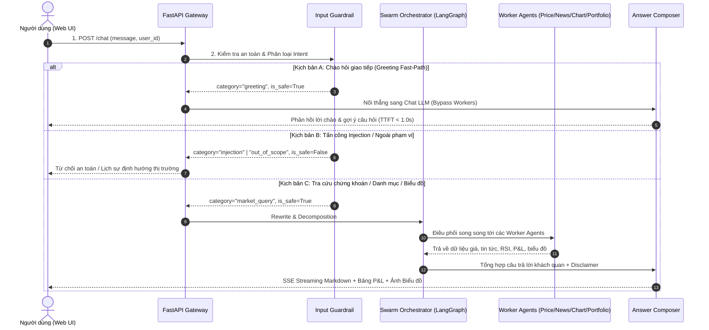

# Product Spec — VN Stock Swarm & Portfolio Watch (Capstone Final Product)

## 1. App Goal (Mục Tiêu Ứng Dụng)
**VN Stock Swarm & Portfolio Watch** là hệ thống trợ lý phân tích chứng khoán Việt Nam và quản lý danh mục đầu tư đa tài khoản ứng dụng kiến trúc Multi-Agent Swarm (LangGraph), phát triển theo phương pháp **Spec-Driven Development (SDD)** làm sản phẩm đồ án tốt nghiệp cuối khóa LLM Engineer.

Mục tiêu cốt lõi:
1. **Trợ lý đầu tư chứng khoán chính xác & khách quan**: Đáp ứng 100% (20/20 cases) bộ dữ liệu chuẩn hóa `golden_v6_comprehensive.yaml` trên 10 lát cắt thị trường, luôn kèm miễn trừ trách nhiệm pháp lý.
2. **Phản hồi tức thì với Greeting Fast-Path**: Nhận diện câu chào hỏi giao tiếp ("Xin chào", "Hello", "Hi bot") an toàn tại Input Guardrail và nối thẳng sang Chat LLM (TTFT < 1.0s), không bị từ chối và không kích hoạt tra cứu giá sai lệch.
3. **Quản lý danh mục đa tài khoản (Multi-tenant Portfolio)**: Cô lập dữ liệu nắm giữ (Holdings, Unrealized P&L, NAV) và danh sách theo dõi (Watchlist) giữa các tài khoản người dùng (`User A`, `User B`, `Default`).
4. **Kiến trúc tinh gọn, bảo mật & tách biệt cấu hình (Config Decoupling)**:
   - File `.env` chỉ chứa các biến bí mật (API Keys).
   - Toàn bộ cấu hình hệ thống được quản lý tập trung tại [resources/configs/config.yaml](file:///d:/Hoc_Tap/YOURClass/Project/vn-stock-swarm/resources/configs/config.yaml).
5. **Mã nguồn sạch sẽ, phân tầng modular**:
   - Toàn bộ code nằm trong `src/` (`src/backend/`, `src/frontend/`, `src/deploy/`), gốc dự án (root) sạch sẽ chỉ chứa các tệp tĩnh.
6. **Kiểm thử 3 tầng chuẩn Production LLMOps**:
   - Phân tầng `tests/unit/`, `tests/integration/`, `tests/e2e/`, hỗ trợ mock offline bảo đảm pipeline CI chạy hoàn tất trong **< 5 phút**.

---

## 2. Target Users (Đối Tượng Người Dùng)
1. **Nhà đầu tư cá nhân trên thị trường chứng khoán Việt Nam**:
   - Cần tra cứu nhanh giá thị trường, tin tức doanh nghiệp, chỉ báo kỹ thuật (RSI, SMA), xem biểu đồ nến Candlestick và theo dõi lãi/lỗ danh mục đầu tư một cách khách quan, bảo mật.
2. **Hội đồng chấm thi / Giảng viên khóa học LLM Engineer**:
   - Đánh giá năng lực xây dựng sản phẩm AI Agent thực tế: Multi-Agent Swarm (LangGraph), Prompt Engineering, 2-Tier Caching, Guardrails, Memory Engineering, Cost Tracking và CI/CD Automation.
3. **Kỹ sư AI / MLOps Developer**:
   - Cần hệ thống mẫu chuẩn mực về Spec-Driven Development, cấu trúc mã nguồn sạch, tách biệt cấu hình và kiểm thử hồi quy tự động (Regression Testing & Eval Gate).

---

## 3. Core User Flow (Luồng Người Dùng Cốt Lõi)

### 3.1. Các bước tương tác chính:
1. **Truy cập & Chọn tài khoản**: Người dùng truy cập Web App (`http://localhost:8000`), chọn tài khoản từ dropdown (`User A`, `User B`, `Default`).
2. **Nhập câu hỏi**: Người dùng gửi tin nhắn (chào hỏi, hỏi giá, tin tức, phân tích kỹ thuật, xem biểu đồ, kiểm tra danh mục, hoặc hỏi khuyến nghị).
3. **Xử lý qua Tường lửa & Swarm Orchestrator**:
   - *Luồng Chào hỏi (Greeting Fast-Path)*: Guardrail nhận diện an toàn -> nối thẳng sang Chat LLM phản hồi thân thiện, giới thiệu năng lực (TTFT < 1.0s, bỏ qua các worker).
   - *Tấn công Injection / Ngoài phạm vi*: Guardrail chặn đứng (Injection) hoặc từ chối lịch sự (Out-of-Scope).
   - *Câu hỏi chứng khoán hợp lệ*: Rewrite chuẩn hóa -> Supervisor phân phối song song tới các Worker Agents tương ứng (`PriceAgent`, `NewsAgent`, `IndicatorEngine`, `ChartAgent`, `PortfolioWatchAgent`) -> `EvalAgent` đánh giá rủi ro -> `AnswerComposer` tổng hợp câu trả lời kèm miễn trừ trách nhiệm.
4. **Phản hồi thời gian thực qua Web UI**:
   - Streaming Markdown qua Server-Sent Events (SSE).
   - Đồ thị Live Agent Graph cập nhật trạng thái node theo thời gian thực (sáng đèn khi xử lý, hover xem I/O).
   - Hiển thị bảng P&L, danh sách Watchlist và ảnh biểu đồ nến Candlestick (nếu có).

### 3.2. Sơ đồ tuần tự (Sequence Diagram):

---

## 4. Features in Scope (Phạm Vi Tính Năng MVP)

### 4.1. Nhóm Tính Năng Nghiệp Vụ Trợ Lý Swarm
1. **Greeting Fast-Path**: Phản hồi chào hỏi tức thì (< 1.0s TTFT), bỏ qua các worker tra cứu giá.
2. **Tường lửa Guardrail**: Chặn 100% prompt injection; từ chối câu hỏi ngoài phạm vi; bắt buộc gắn miễn trừ trách nhiệm.
3. **Tra cứu thị giá (Price Agent)**: Giá khớp lệnh, % thay đổi, trần/sàn, lịch sử giá 10 ngày từ Vnstock (có fallback offline).
4. **Tổng hợp tin tức (News Agent)**: Thu thập tin tức mới nhất từ Vnstock & CafeF, trích dẫn nguồn minh bạch.
5. **Chỉ báo kỹ thuật (Indicator Engine)**: Tính toán định lượng RSI(14), SMA(20), SMA(50), nhận diện Golden/Death Cross.
6. **So sánh đa mã (Comparison)**: Phân rã câu hỏi so sánh đa mã và đối chiếu trong bảng Markdown.
7. **Sinh biểu đồ nến (Chart Agent)**: Vẽ biểu đồ nến Candlestick kết hợp SMA bằng Matplotlib, lưu ảnh PNG tĩnh tại `resources/data/charts/`.
8. **Quản lý danh mục & Watchlist (PortfolioWatchAgent)**: Tính Unrealized P&L, tổng NAV và quản lý danh sách theo dõi kèm ngưỡng cảnh báo theo từng `user_id`.
9. **Giao diện Web App & Live Agent Graph**: Streaming SSE, hiển thị đồ thị mạng lưới Agent động, bảng P&L và User Switcher.

### 4.2. Nhóm Tính Năng Kỹ Thuật & Cấu Trúc Sạch (Engineering & LLMOps)
1. **Tách biệt cấu hình (Config Decoupling)**: `.env` chỉ chứa secrets; `resources/configs/config.yaml` chứa toàn bộ tham số vận hành.
2. **Module hóa `src/backend/`**: Đóng gói các chức năng vào folder riêng (`api`, `agents`, `domain`, `infra`, `services`, `eval`), không để file rời rạc ở thư mục gốc backend.
3. **Di dời `deploy/` vào `src/deploy/`**: Gom toàn bộ mã nguồn và script triển khai vào `src/`.
4. **Bộ nhớ đệm 2 tầng (2-Tier Cache)**: Exact MD5 Cache + Semantic Cosine Cache ($\ge 0.93$) giúp tiết kiệm 30% chi phí.
5. **Bộ nhớ ngắn hạn (Short-term Memory)**: Sliding window 20 tin nhắn với TTL 60 phút.
6. **Kiểm thử 3 tầng (3-Tier Testing Pyramid)**: `tests/unit/`, `tests/integration/`, `tests/e2e/` với cơ chế mock offline < 5 phút.

---

## 5. Features out of Scope (Ngoài Phạm Vi MVP)

Để đảm bảo tính đơn giản, tập trung vào MVP và chuẩn mực đồ án cuối khóa:
1. **Không đặt lệnh giao dịch thật**: Không tích hợp API tài khoản chứng khoán để mua/bán tiền thật.
2. **Không truyền phát tick-by-tick thời gian thực**: Sử dụng nến ngày EOD và polling giá khớp gần nhất.
3. **Không làm hệ thống Authentication / RBAC phức tạp**: Sử dụng User Switcher qua header `X-User-ID` để phân tách tenant.
4. **Không tính thuế & phí margin chi tiết**: Chưa hỗ trợ thuế TNCN chi tiết, phí lưu ký hay lãi vay margin phức tạp.
5. **Không hỗ trợ thị trường tài chính quốc tế**: Chỉ tập trung vào cổ phiếu niêm yết tại thị trường chứng khoán Việt Nam (rổ VN30, HOSE, HNX).

---

## 6. Acceptance Criteria (Tiêu Chí Nghiệm Thu Định Lượng)

| Mã AC | Tiêu Chí Nghiệm Thu | Ngưỡng Đạt Yêu Cầu | Phương Pháp Đo Kiểm |
| :--- | :--- | :--- | :--- |
| **AC-1** | **Độ chính xác Golden Dataset v6** | **20/20 test cases PASS (100%)** trên 10 lát cắt chuẩn | `pytest tests/e2e/test_golden_v6_slices.py` |
| **AC-2** | **Greeting Fast-Path Latency** | **TTFT < 1.0s**, không bị Guardrail chặn, không gọi PriceAgent | `pytest tests/unit/test_greeting_fastpath.py` |
| **AC-3** | **Tường Lửa Guardrail & An Toàn** | 100% Injection bị chặn, 100% Out-of-Scope được từ chối an toàn | `pytest tests/unit/test_guardrails.py` |
| **AC-4** | **Phân Tách Dữ Liệu Đa Tài Khoản** | P&L, NAV, Watchlist cô lập 100% giữa User A và User B | `pytest tests/integration/test_database.py` |
| **AC-5** | **Tự Động Sinh Biểu Đồ Nến** | File PNG sinh hợp lệ trong `resources/data/charts/`, hiển thị trên UI | `pytest tests/integration/test_chart.py` |
| **AC-6** | **Bảo Đảm Miễn Trừ Trách Nhiệm** | 100% câu hỏi xin khuyến nghị có chứa "miễn trừ trách nhiệm", không chứa "nên mua/bán" | `pytest tests/e2e/test_eval.py` |
| **AC-7** | **Tách Biệt Config & Secret** | `.env` chỉ chứa Secrets; `config.yaml` nạp đầy đủ tham số hệ thống | `pytest tests/unit/test_config.py` |
| **AC-8** | **Cấu Trúc Thư Mục Chuẩn Sạch** | Toàn bộ code trong `src/`; không còn loose files trong `src/backend/` | Kiểm tra cấu trúc filesystem |
| **AC-9** | **Tối Ưu Thời Gian CI Pipeline** | Toàn bộ test suite chạy hoàn tất trong **< 5 phút** trên GitHub Actions | `.github/workflows/ci.yml` run log |
| **AC-10**| **Hiệu Quả 2-Tier Caching** | Tỷ lệ trúng cache $\ge 30\%$ trên tập Replay FAQ 200 câu, tiết kiệm $\ge 30\%$ chi phí | `python scripts/cache_benchmark.py --limit 50` |
