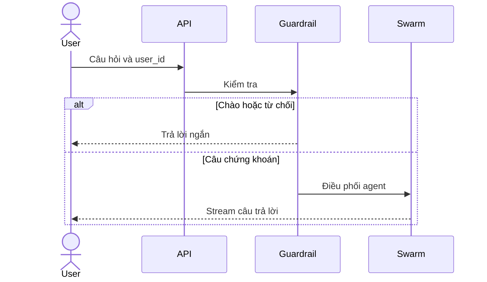

# Product Spec — VN Stock Swarm & Portfolio Watch

## App goal

VN Stock Swarm là web app trợ lý chứng khoán Việt Nam. Người dùng hỏi giá, tin, chỉ báo, biểu đồ, và danh mục. Hệ thống trả lời bằng nhiều agent, kèm miễn trừ trách nhiệm, và không đặt lệnh mua bán.

Đợt này vá các lỗ LLMOps còn lại so với `llm-engineer-demo` sau commit `01bd450` đến `6e5e32e`. Module III Bài 1–8 đã có trong code. Mục tiêu là khép những lỗ đó, giữ golden v6 và suite test hiện tại.

## Target users

- Nhà đầu tư cá nhân tra cứu cổ phiếu Việt Nam và xem lãi lỗ danh mục theo tài khoản đã chọn.
- Giảng viên chấm phần agent và phần vận hành LLM (prompt, eval, cache, trace, CI).
- Người chạy demo local hoặc ngrok trên máy mình.

## Core user flow

1. Mở `http://localhost:8000`, chọn User A, User B, hoặc Default.
2. Gửi một câu: chào, hỏi giá, tin, chỉ báo, so sánh mã, biểu đồ, danh mục, hoặc xin khuyến nghị.
3. Guardrail xử lý trước:
   - Chào hỏi đi thẳng tới câu trả lời, không gọi agent giá.
   - Injection hoặc câu ngoài chứng khoán Việt Nam bị từ chối.
   - Câu hợp lệ đi qua supervisor tới agent giá, tin, chỉ báo, biểu đồ, hoặc danh mục.
4. UI nhận câu trả lời dạng stream. Có thể kèm bảng lãi lỗ hoặc ảnh nến.
5. User bấm thích hoặc không thích. Bản ghi này có thể thành draft cho bộ golden.

Đợt vá thêm vào đúng luồng trên, không thêm màn hình mới:

- Câu lặp trên luồng stream dùng cache, hết slot thì xếp hàng, client ngắt thì dừng sinh token.
- Trace bỏ các lượt trúng cache. User có thể gửi thêm tín hiệu đã copy, hỏi lại, hoặc bỏ dở.
- Máy production đọc API key từ Secret Manager. Lỗi thì dùng `.env`.

## Features in scope

Đã có, không xây lại:

- Chào hỏi, chặn injection, từ chối câu ngoài phạm vi, miễn trừ trách nhiệm.
- Giá, tin, RSI/SMA, so sánh mã, biểu đồ nến, lãi lỗ và watchlist theo `user_id`.
- Prompt YAML với alias `production`, lint, A/B.
- Golden v6, eval gate, cache exact và semantic trong memory trên `chat()` và `chat_parsed()`.
- SSE, dừng khi client ngắt, semaphore thread, Docker, nginx, smoke, ngrok.
- CI lint, eval gate trên PR, CD build rồi smoke rồi rollback SHA.
- Sampling lỗi, guardrail, request chậm, che email và số điện thoại, HITL thumbs.

Đợt này làm thêm:

- `chat_stream` gọi LLM async, có giới hạn đồng thời, và đi qua exact cache.
- Redis cho exact cache. Mặc định vẫn memory.
- Script đổi alias `production` về version trước.
- Sampling bỏ lượt cache hit. Thêm tín hiệu copied, regenerated, abandoned.
- Đọc secret lúc chạy, lỗi thì giữ `.env`.

## Features out of scope

- Đặt lệnh mua bán, dữ liệu tick, đăng nhập đầy đủ, thuế và phí margin, thị trường ngoài Việt Nam.
- Viết lại swarm, golden set, lint prompt, eval gate, cache memory, HITL thumbs.
- RAG pháp lý, Tavily, Qdrant cho luật, LangSmith Prompt Hub, đồng bộ golden lên LangSmith.
- vLLM trên GPU và script tạo máy Compute Engine.

## Acceptance criteria

Sản phẩm hiện tại phải giữ:

| Mã | Đạt khi | Cách kiểm |
| :--- | :--- | :--- |
| AC-1 | Golden v6 đủ 20/20 trên 10 lát cắt | `pytest tests/e2e/test_golden_v6_slices.py` |
| AC-2 | Câu chào không bị chặn và không gọi agent giá | `pytest tests/unit/test_greeting_fastpath.py` |
| AC-3 | Injection bị chặn, câu ngoài phạm vi bị từ chối | `pytest tests/unit/test_guardrails.py` |
| AC-4 | Lãi lỗ và watchlist của User A khác User B | `pytest tests/integration/test_database.py` |
| AC-5 | Biểu đồ PNG tạo được | `pytest tests/integration/test_chart.py` |
| AC-6 | Câu xin khuyến nghị có "miễn trừ trách nhiệm" | `pytest tests/e2e/test_eval.py` |
| AC-7 | `.env` chỉ chứa secret, app đọc `config.yaml` | `pytest tests/unit/test_config.py` |

Đợt vá đạt khi:

| Mã | Đạt khi |
| :--- | :--- |
| U1 | `chat_stream` dùng async client. Slot được trả sau khi xong hoặc lỗi. Test không gọi mạng. |
| U2 | Cùng câu và cùng `prompt_version` trên stream thì không gọi model. |
| U3 | Redis store chỉ cần `get` và `setex`. Test dùng store giả. |
| U4 | Script rollback đổi `production.txt` và giữ file version. |
| U5 | Cache hit thì không ghi trace. Lỗi, guardrail, và request chậm vẫn ghi. |
| U6 | Copied, regenerated, abandoned có điểm từ 0 đến 1 và nhãn nguồn. |
| U7 | Secret Manager bật: mock trả key thì dùng key đó. Mock lỗi thì giữ `.env`. |
| U8 | `pytest tests/` vẫn pass, không gọi internet. |
