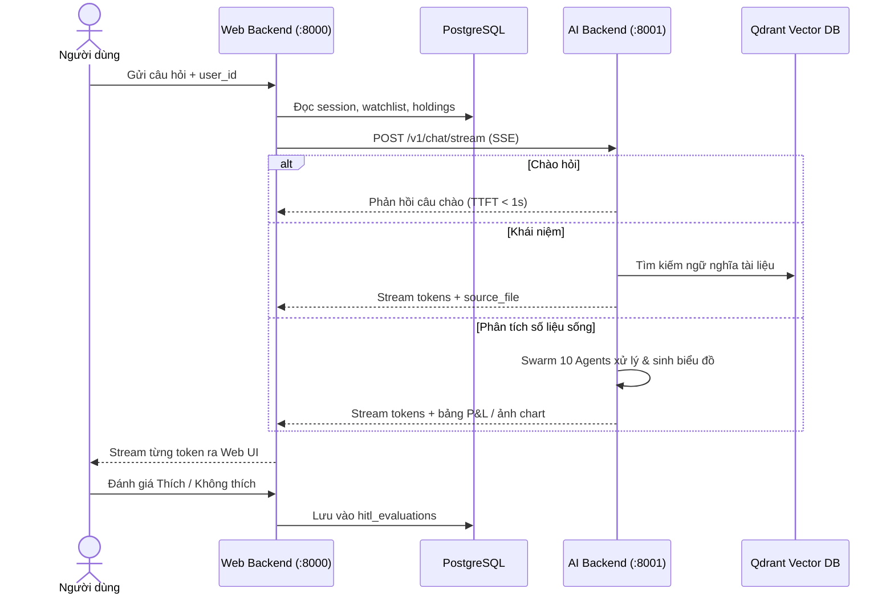

# Product Spec — VN Stock Swarm & Portfolio Watch

## App Goal

VN Stock Swarm là ứng dụng web trợ lý tài chính chứng khoán Việt Nam sử dụng hệ thống Đa Tác tử (Multi-Agent Swarm) và Quản lý danh mục đầu tư đa tài khoản (Multi-tenant Portfolio Watch). Ứng dụng cung cấp thông tin tra cứu thị giá, tin tức doanh nghiệp, chỉ báo kỹ thuật (RSI, SMA), biểu đồ nến, phân tích lãi/lỗ danh mục và giải thích các khái niệm tài chính kèm trích dẫn nguồn tài liệu. Ứng dụng luôn kèm miễn trừ trách nhiệm và **tuyệt đối không đặt lệnh mua bán chứng khoán thật**.

Mục tiêu cốt lõi của đợt refactor này là tái cấu trúc toàn bộ mã nguồn `src/backend` theo phương pháp **Spec-Driven Development (SDD)** và kiến trúc **Clean Architecture** (dựa trên chuẩn thiết kế của `AI_Face_checkin`), phân tách thành 3 khối chuyên biệt:
1. **`src/common/` (Shared Kernel)**: Khối dùng chung chứa `CustomBaseModel`, `BaseService`/`AsyncBaseService` (`process(input) -> output`), thực thể cốt lõi, công thức toán chỉ báo thuần túy, ports trừu tượng, logging có Correlation ID, settings/secrets, và transport client.
2. **`src/web_backend/` (Web Microservice - Cổng 8000)**: Đóng vai trò Web Gateway, quản lý Session, Watchlist, Portfolio P&L, phản hồi HITL, và stream SSE ra UI. Tuyệt đối không import LLM SDK (`openai`) hay AI Swarm.
3. **`src/ai_backend/` (AI Microservice - Cổng 8001)**: Đóng vai trò AI Engine độc lập, chỉ phục vụ các endpoint `/health`, `/v1/chat/stream`, `/v1/scan`. Điều phối LangGraph Swarm 10 Agents, RAG khái niệm với Qdrant, bộ Guardrails 2 lớp, Cache 2 tầng và Eval Gate.

---

## Target Users

1. **Nhà đầu tư cá nhân**:
   - Tra cứu nhanh giá cổ phiếu (OHLCV), biến động phiên, tin tức tài chính thị trường Việt Nam.
   - Tính toán lãi/lỗ thực tế (Unrealized P&L), tổng giá trị tài sản (NAV) theo từng tài khoản riêng biệt (`User A`, `User B`, `Default`).
   - Hỏi đáp định nghĩa các khái niệm chứng khoán chuẩn xác từ tài liệu chính quy.
2. **Hội đồng chấm đồ án / Giảng viên**:
   - Đánh giá kiến trúc Clean Architecture phân tầng microservice rõ ràng, không import chéo.
   - Kiểm tra năng lực Production LLMOps: RAG trích dẫn nguồn, 2-Tier Cache, Guardrails, và tỷ lệ đạt 100% (20/20 test cases) của bộ kiểm chuẩn Golden Dataset v6.
3. **Kỹ sư vận hành (DevOps / Local Deployer)**:
   - Triển khai toàn bộ giải pháp từ máy cục bộ qua Docker Compose 7 container, Nginx Reverse Proxy cổng 80, và công khai ra internet bằng Cloudflare Tunnel (`publish.ps1`) hoặc ngrok để demo.

---

## Core User Flow

1. **Mở ứng dụng**: Người dùng truy cập `http://localhost:8000` (hoặc cổng 3001 trên Docker, hoặc URL Cloudflare Tunnel/ngrok), chọn hồ sơ người dùng (`User A`, `User B`, hoặc `Default`).
2. **Gửi câu hỏi**: Người dùng nhập câu hỏi vào khung chat:
   - *Chào hỏi giao tiếp*: "Xin chào", "Hello bot".
   - *Tra cứu số liệu sống*: Giá cổ phiếu, tin tức, chỉ báo RSI/SMA, vẽ biểu đồ nến, hoặc kiểm tra lãi/lỗ danh mục.
   - *Hỏi khái niệm tài chính*: "RSI là gì", "Lệnh ATO là gì".
   - *Thử nghiệm tấn công / Phi phạm vi*: Prompt injection, hỏi thời tiết, hoặc xin khuyến nghị đầu tư trực tiếp.
3. **Xử lý tại Web Gateway (Cổng 8000)**:
   - Web Backend nạp lịch sử session và snapshot danh mục (`holdings`, `watchlist`) của user hiện tại từ PostgreSQL.
   - Chuyển tiếp yêu cầu sang AI Backend qua HTTP POST `/v1/chat/stream`.
4. **Điều phối tại AI Engine (Cổng 8001)**:
   - *Luồng Chào hỏi (Fast-path)*: Phản hồi tức thì với TTFT < 1s, bỏ qua toàn bộ agent tra cứu giá.
   - *Luồng Tường lửa (Guardrails)*: Chặn 100% câu hỏi injection hoặc ngoài phạm vi; bắt buộc gắn "miễn trừ trách nhiệm" nếu xin khuyến nghị.
   - *Luồng Khái niệm (Concept RAG)*: Truy xuất ngữ nghĩa từ Qdrant trong 5 tài liệu markdown, đính kèm tên file nguồn (`source_file`).
   - *Luồng Swarm 10 Agents*: Kiểm tra Cache 2 tầng; nếu cache miss, StateGraph phân luồng các worker (`PriceAgent`, `NewsAgent`, `EvalAgent`, `ChartAgent`, `PortfolioWatchAgent`...) tổng hợp dữ liệu.
5. **Hiển thị kết quả**:
   - Web Backend chuyển tiếp trực tiếp từng token SSE từ AI ra Web UI mà không bị đệm (no buffering).
   - Khung chat hiển thị câu trả lời Markdown, bảng P&L, biểu đồ nến, và trích dẫn nguồn tài liệu.
6. **Tương tác phản hồi (HITL)**:
   - Người dùng bấm nút Thích (Thumbs Up) hoặc Không thích (Thumbs Down).
   - Web Backend ghi nhận tín hiệu phản hồi vào bảng `hitl_evaluations` trong PostgreSQL.

---

## Features In Scope

### 1. Kiến trúc Clean Architecture 3 Khối
- **Khối dùng chung (`src/common/`)**: `CustomBaseModel`, `BaseService`, `AsyncBaseService`, thực thể nghiệp vụ (`entities`), công thức toán kỹ thuật thuần túy (`indicators`), logging có Correlation ID, settings & secrets, HTTP transport client.
- **Microservice Web Gateway (`src/web_backend/`)**: Cổng 8000, cấu hình CORS, API routes (`chat`, `portfolio`, `watchlist`, `sessions`, `hitl`, `market`, `approvals`, `scan`), use cases kế thừa `BaseService`, PostgreSQL driver psycopg3 kèm SQLite fallback, remote AI client.
- **Microservice AI Swarm Engine (`src/ai_backend/`)**: Cổng 8001, các routes `/health`, `/v1/chat/stream`, `/v1/scan`. Điều phối StateGraph LangGraph Swarm, 10 Worker Agents, RAG tài liệu khái niệm với Qdrant, Guardrails, Cache 2 tầng (Redis/Memory), Cost/Token tracker.

### 2. Nghiệp Vụ Trợ Lý Chứng Khoán
- **Tra cứu giá & tin tức**: Giá realtime/lịch sử từ Vnstock (kèm offline mock fallback), tin tức doanh nghiệp từ CafeF/Vnstock.
- **Chỉ báo kỹ thuật**: Tính toán RSI(14), SMA(20), SMA(50), nhận diện Golden Cross & Death Cross.
- **Vẽ biểu đồ nến**: Tự động sinh ảnh biểu đồ Candlestick bằng Matplotlib và lưu trữ trên MinIO/cục bộ.
- **Quản lý danh mục P&L & Watchlist**: Tính toán chi phí vốn, giá trị thị trường, Unrealized P&L, NAV độc lập theo `user_id`.
- **RAG Khái niệm**: Giải thích khái niệm tài chính chuẩn xác từ 5 tệp markdown, trích dẫn rõ `source_file`.

### 3. An Toàn & Đánh Giá Chất Lượng LLMOps
- **Greeting Fast-Path**: Phản hồi chào hỏi tức thì (TTFT < 1s) không qua LLM Swarm.
- **Input Guardrail**: Ngăn chặn 100% Prompt Injection, từ chối câu hỏi ngoài phạm vi tài chính.
- **Output Guardrail**: Bắt buộc tuyên bố miễn trừ trách nhiệm khi người dùng hỏi khuyến nghị, từ chối khẳng định "nên mua/bán".
- **Bộ kiểm chuẩn Golden Dataset v6**: 20 câu hỏi đại diện cho 10 lát cắt chức năng đạt tỷ lệ Pass 100%.

### 4. Vận Hành & Triển Khai
- **Docker Compose**: Khởi chạy 7 container phân tách nhiệm vụ rõ ràng (`web_backend`, `ai_backend`, `frontend`, `redis`, `postgres`, `minio`, `qdrant`).
- **Nginx Reverse Proxy**: Nghe cổng 80, chuyển tiếp vào cổng 8000, tắt đệm `proxy_buffering off` cho route stream SSE.
- **Public Demo**: Kịch bản mở HTTPS ra internet bằng Cloudflare Tunnel (`src/deploy/publish.ps1`) hoặc ngrok.

---

## Features Out of Scope

- **Đặt lệnh giao dịch**: Tuyệt đối không kết nối API đặt lệnh mua/bán thật vào tài khoản sàn chứng khoán.
- **Dữ liệu tần số cao (Tick-by-tick)**: Không hỗ trợ streaming dữ liệu giao dịch mili-giây (HFT).
- **Hệ thống xác thực phức tạp**: Không xây dựng hệ thống OAuth2, JWT Refresh token hay phân quyền phức tạp; duy trì cơ chế chọn tài khoản mẫu đơn giản (`User A`, `User B`, `Default`).
- **Triển khai Cloud trả phí**: Không thuê máy chủ AWS/GCP/Azure; toàn bộ vận hành trên máy local + Tunnel.
- **Thay đổi câu hỏi Golden Dataset v6**: Giữ nguyên vẹn 20 test cases chuẩn trong `golden_v6_comprehensive.yaml`.
- **Tạo các package trung gian**: Không tạo `src/backend`, `src/ai`, hay `src/web`.

---

## Acceptance Criteria

| Mã | Tiêu Chí Nghiệm Thu | Phương Pháp & Lệnh Kiểm Tra |
| :--- | :--- | :--- |
| **AC-1** | Toàn bộ mã nguồn nằm gọn trong 3 khối (`src/common`, `src/web_backend`, `src/ai_backend`). Xóa bỏ hoàn toàn thư mục cũ `src/backend`. | `pytest tests/e2e/test_docker_setup.py -q` |
| **AC-2** | Phân lập ranh giới import: `src/web_backend` tuyệt đối không import từ `src/ai_backend`, không import `openai`, không import `langgraph`. | `pytest src/common/tests/test_config.py -q` |
| **AC-3** | Kế thừa chuẩn `AI_Face_checkin`: Các use cases trong `application/` kế thừa `BaseService` hoặc `AsyncBaseService` (`process(input) -> output`), sử dụng `CustomBaseModel`. | `pytest src/common/tests/ -q` |
| **AC-4** | Web Backend phục vụ cổng 8000 (`web_backend.main:app`), AI Backend phục vụ cổng 8001 (`ai_backend.main:app`). Cả hai endpoint `/health` đều trả HTTP 200. | `curl -f http://127.0.0.1:8000/health && curl -f http://127.0.0.1:8001/health` |
| **AC-5** | Đạt tỷ lệ 100% (20/20 test cases) trên 10 lát cắt chức năng của bộ dữ liệu kiểm chuẩn Golden Dataset v6. | `pytest tests/e2e/test_golden_v6_slices.py -q` |
| **AC-6** | Luồng chào hỏi (Greeting Fast-Path) phản hồi tức thì với TTFT < 1.0s, không gọi Agent giá. | `pytest src/ai_backend/tests/test_greeting_fastpath.py -q` |
| **AC-7** | Tường lửa Input Guardrail chặn 100% Prompt Injection và từ chối các câu hỏi ngoài phạm vi. | `pytest src/ai_backend/tests/test_guardrails.py -q` |
| **AC-8** | Câu hỏi khái niệm (ví dụ: "RSI là gì") truy xuất đúng đoạn văn từ Qdrant và ghi rõ `source_file`. Nếu không có dữ liệu, trả về `"Không có trong tài liệu."`. | `pytest src/ai_backend/tests/test_concept_rag.py -q` |
| **AC-9** | Phản hồi SSE truyền tải từng token mượt mà từ AI sang Web và ra UI. Khi client đóng kết nối, pipeline xử lý tự động dừng. | `pytest src/ai_backend/tests/test_ai_http_stream.py -q` |
| **AC-10**| Đầy đủ 4 tầng kiểm thử (`common/tests`, `web_backend/tests`, `ai_backend/tests`, `tests/e2e`), thực thi 100% offline không cần internet. | `pytest src/ tests/ -q` |
| **AC-11**| Docker Compose hỗ trợ 7 container hoạt động ổn định (`web_backend`, `ai_backend`, `frontend`, `redis`, `postgres`, `minio`, `qdrant`). | `pytest tests/e2e/test_docker_setup.py -q` |
| **AC-12**| Nginx là cổng duy nhất (Cổng 80) proxy vào Web Backend (8000), route `/chat` tắt `proxy_buffering`. `release.ps1` hỗ trợ đầy đủ `up`, `smoke`, `rollback`, `status`. | `pytest tests/integration/test_system.py -q` |
