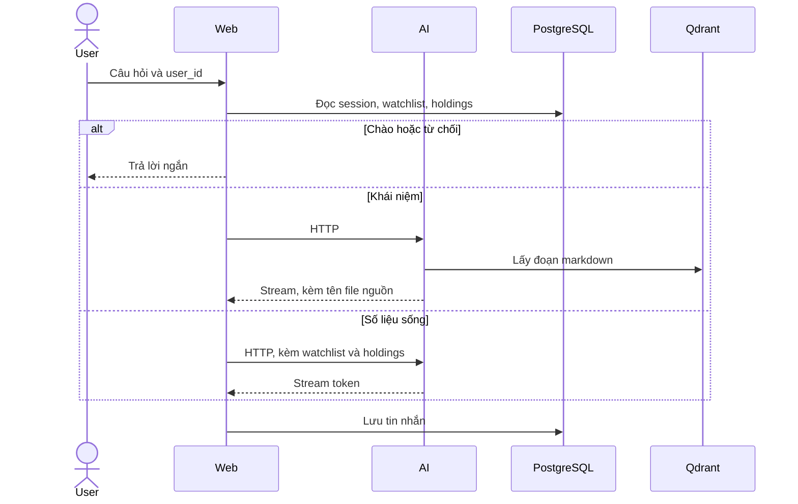

# Product Spec — VN Stock Swarm & Portfolio Watch

## App goal

VN Stock Swarm là web app trợ lý chứng khoán Việt Nam. Người dùng hỏi giá, tin, chỉ báo, khái niệm, biểu đồ, và danh mục. Hệ thống trả lời bằng nhiều agent, kèm miễn trừ trách nhiệm, và không đặt lệnh mua bán.

Câu khái niệm, ví dụ "RSI là gì", chỉ trả lời từ tài liệu có sẵn và ghi tên file nguồn. Câu số liệu sống, ví dụ "RSI của HPG", vẫn lấy dữ liệu thị trường.

Đợt này tách mã thành web backend và AI backend, rồi public app từ chính máy này. Nginx trên máy là cửa duy nhất. Cloudflare Tunnel đưa một URL https ra internet. Chat, swarm, UI, và golden v6 giữ nguyên.

## Target users

- Nhà đầu tư cá nhân tra cứu cổ phiếu Việt Nam, hỏi nghĩa một khái niệm, và xem lãi lỗ danh mục theo tài khoản đã chọn.
- Giảng viên chấm hai service, nhánh tài liệu, và database.
- Người chạy app trên máy mình và gửi URL https cho người khác mở.

## Core user flow

1. Mở `http://localhost:8000`, frontend Docker cổng 3001, hoặc URL https của Cloudflare Tunnel. Chọn User A, User B, hoặc Default.
2. Gửi một câu: chào, hỏi giá, tin, chỉ báo, khái niệm, so sánh mã, biểu đồ, danh mục, hoặc xin khuyến nghị.
3. Web backend lưu session và kiểm tra câu:
   - Chào hỏi được trả lời ngay, không gọi agent giá.
   - Injection hoặc câu ngoài chứng khoán Việt Nam bị từ chối.
   - Câu hợp lệ gửi sang AI backend bằng HTTP. Câu số liệu hoặc danh mục kèm watchlist và holdings. Câu khái niệm không kèm hai danh sách này.
4. AI backend trả stream. Web chỉ chuyển token ra UI.
   - Câu khái niệm dùng đoạn lấy từ Qdrant và ghi tên file nguồn.
   - Câu số liệu sống đi agent giá, tin, chỉ báo, biểu đồ, hoặc danh mục.
5. User bấm thích hoặc không thích. Web ghi bản ghi này vào PostgreSQL.
6. Chủ máy chạy tunnel. Người khác mở URL https đó và làm lại bước 1 đến 5.

## Features in scope

Giữ, không xây lại:

- Chào hỏi, chặn injection, từ chối câu ngoài phạm vi, miễn trừ trách nhiệm.
- Giá, tin, RSI/SMA theo mã, so sánh mã, biểu đồ nến, lãi lỗ và watchlist theo `user_id`.
- SSE từng token, nút thích và không thích ghi PostgreSQL.
- AI chỉ có `/health`, `/v1/chat`, `/v1/chat/stream`, `/v1/scan`.
- Postgres cho dữ liệu app. Qdrant cho năm file khái niệm. Redis và MinIO giữ container riêng.
- "RSI là gì" đi retrieval. "RSI của HPG" đi agent chỉ báo. Thiếu đoạn thì nói không có trong tài liệu.

Làm trong đợt này:

- `src/web_backend` cổng 8000 và `src/ai_backend` cổng 8001. Hai cây không import lẫn nhau. Phần chung chỉ `src/shared`.
- Nginx nghe cổng 80, chuyển vào web `127.0.0.1:8000`. Route stream tắt `proxy_buffering`.
- `release.ps1` có up, smoke, rollback, status.
- Public HTTPS bằng Cloudflare Tunnel. ngrok giữ cho demo vài phút.

## Features out of scope

- Đặt lệnh mua bán, dữ liệu tick, đăng nhập đầy đủ, thuế và phí margin, thị trường ngoài Việt Nam.
- Viết lại swarm, UI, golden set, cache, hoặc HITL.
- RAG pháp lý, tìm web khi thiếu tài liệu, tách một câu thành nhiều subquery, rerank.
- Package `src/ai`, `src/web`, hoặc giữ `src/backend` song song sau khi tách xong.
- Sửa 20 ca golden v6.
- Thuê VM, dùng `gcloud`, mua tên miền, mở port router, hoặc viết sẵn nginx `listen 443`.

## Acceptance criteria

| Mã | Đạt khi | Cách kiểm |
| :--- | :--- | :--- |
| AC-1 | Golden v6 đủ 20/20 trên 10 lát cắt | `pytest tests/e2e/test_golden_v6_slices.py` |
| AC-2 | Câu chào không gọi agent giá | `pytest tests/unit/test_greeting_fastpath.py` |
| AC-3 | Injection bị chặn. Câu ngoài phạm vi bị từ chối | `pytest tests/unit/test_guardrails.py` |
| AC-4 | "RSI là gì" có tên file nguồn. "RSI của HPG" không đi retrieval. Thiếu đoạn thì nói không có trong tài liệu | `pytest tests/unit/test_concept_rag.py` |
| AC-5 | UI nhận từng token. Web chỉ chuyển SSE từ AI | `pytest tests/unit/test_ai_http_stream.py` |
| AC-6 | Web là `web_backend`, AI là `ai_backend`. Không còn `src/backend`. Hai cây không import lẫn nhau | `pytest tests/e2e/test_docker_setup.py tests/unit/test_config.py` |
| AC-7 | Process web không import `openai` hay `answer_question` | `pytest tests/unit/test_config.py` |
| AC-8 | Nginx là cửa public. App nghe `127.0.0.1`. Route `/chat` tắt `proxy_buffering` | `pytest tests/integration/test_system.py` |
| AC-9 | `release.ps1` có up, smoke, rollback, status, và không gọi `gcloud` | Đọc `src/deploy/release.ps1` |
| AC-10 | URL https của tunnel trả `GET /health` 200 | Làm theo README |
| AC-11 | `pytest tests/` pass, không gọi internet, không tạo file `.db` | `pytest tests/` |
